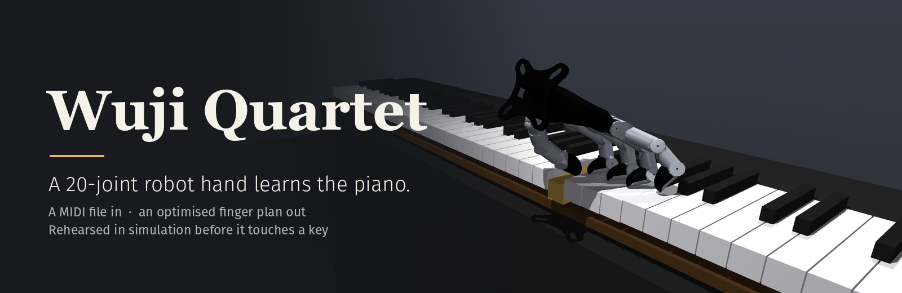
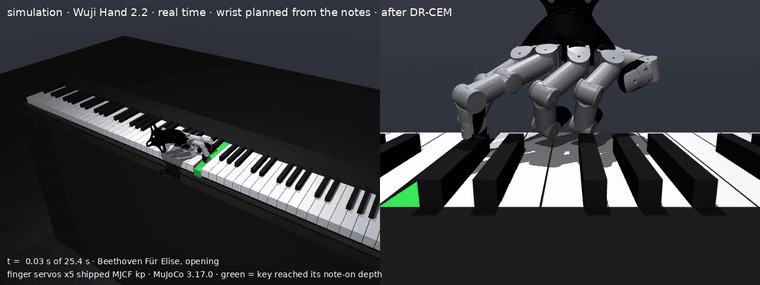
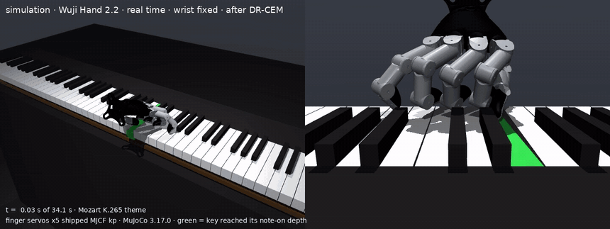
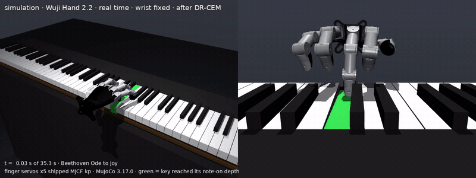
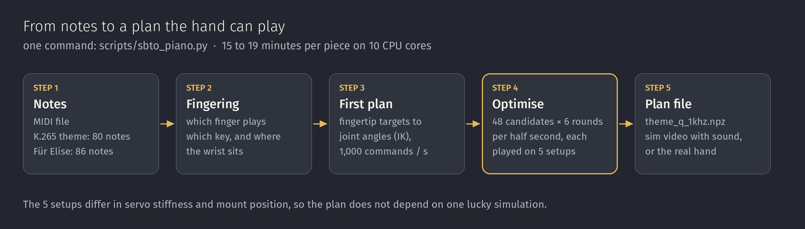
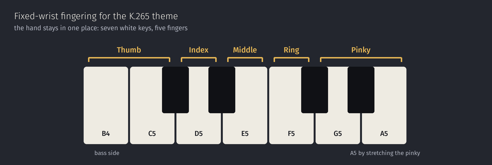
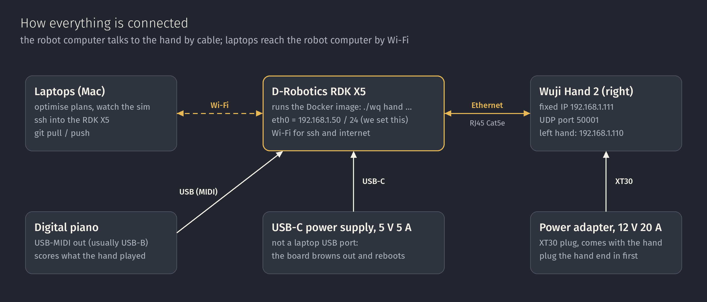

<div align="center">



<br><br>


**Give it a MIDI file. Get a finger plan a Wuji Hand 2 can play.**
<br>
The plan is optimised in simulation on five slightly different pianos at once, so it survives a mount that is a millimetre off.

<sub>Leukerbad Hackathon · Sat 14 Nov 10:00 to Mon 16 Nov 17:00, 2026 · Simon, Henry, Sima, Sebas</sub>

</div>

<br>

| **76 / 80** notes | **82 / 86** notes | **17 to 21 ms** | **15 to 19 min** |
|:--:|:--:|:--:|:--:|
| Mozart K.265 theme, hand alone | Für Elise opening, moving wrist | timing of 90 % of the notes it hits | to optimise one piece on 10 CPU cores |

> **The numbers on this page are simulation.** On 14 Nov the real hand played Ode to Joy **in the air** (half and full speed, 0.5 A and 1.0 A). Nothing has touched a piano yet. What we measured is in [docs/RUNBOOK.md](docs/RUNBOOK.md).

## Watch it play

Click a clip for the video with sound. The sound is synthesised from the keys the simulation pressed, wrong notes included.

<table>
  <tr>
    <th width="50%">Für Elise, opening</th>
    <th width="50%">Mozart K.265 theme ("Twinkle, twinkle")</th>
  </tr>
  <tr>
    <td align="center"><a href="docs/media/furelise_plan.mp4"></a></td>
    <td align="center"><a href="docs/media/k265_fixed.mp4"></a></td>
  </tr>
  <tr>
    <td>Wrist moves, 27 hand shifts in 25 s. <strong>82 / 86</strong> notes. Needs an arm.</td>
    <td>Wrist bolted in place. <strong>76 / 80</strong> notes. <strong>The plan for the real hand.</strong></td>
  </tr>
</table>

<p align="center">
  <a href="docs/media/ode_level.mp4"></a>
  <br>
  <strong>Ode to Joy</strong>: five keys, one finger each, the hand never moves. <strong>62 / 62</strong> notes, 0 wrong, on all ten test setups. Level hand, wrist further back, fingers nearly straight. The piece for the first test on the tripod.
</p>

Third clip, K.265 with the wrist following a human pianist: [docs/media/k265_human.mp4](docs/media/k265_human.mp4) (75 / 80).

## The hand

<p align="center"></p>

## How it works

<p align="center"></p>

The optimiser is sampling-based trajectory optimisation in the style of SBTO: it tries 48 variations of the next half second of music, keeps the best 8, and repeats 6 times. For every note it tunes **when** to press, **how deep**, and small **sideways and forward** corrections. Every variation is played on five simulated setups, and the average decides.

<table>
  <tr>
    <td width="50%"></td>
    <td width="50%"></td>
  </tr>
</table>

## Results in simulation

Notes hit, before and after optimisation. "Setups" vary servo stiffness and mount position; the unseen ones were never shown to the optimiser.

| Piece | Wrist | Our best guess of the setup | 5 training setups | 5 unseen setups | Wrong notes |
|---|---|:--:|:--:|:--:|:--:|
| Ode to Joy, 62 notes, level mount | fixed | 0 → **62** | 0 to 62 → 62 | 0 to 33 → 62 | 0 |
| Ode to Joy, 62 notes, first mount | fixed | 62 → **61** | 0 to 62 → 30 to 62 | 11 to 62 → 28 to 62 | 0 |
| K.265 theme, 80 notes | fixed | 69 → **76** | 4 to 69 → 47 to 76 | 14 to 65 → 40 to 74 | 1 |
| Für Elise opening, 86 notes | planned from the notes | 72 → **82** | 47 to 75 → 81 to 83 | 5 to 69 → 60 to 83 | 8 |
| K.265 theme, 80 notes | follows a human pianist | 58 → **75** | 38 to 62 → 70 to 75 | 13 to 60 → 56 to 74 | 4 |

- The worst unseen setup still loses half the notes. Calibrating on the real piano stays necessary.
- The fixed-wrist run was trained on a wide range (mount ±2 mm, stiffness 2.5 to 10 times the model's default), the other two on a narrow one (±1 mm, 3.5 to 7 times).
- Source: `plans/*/report.json`.

---

# Weekend plan

## Next actions

Owners are a proposal. Edit this table when things change.

| # | Action | Owner | Status |
|:--:|---|---|:--:|
| 1 | Push the simulation code to its own GitHub repo | Simon | ✅ this repo |
| 2 | Set up the environment on every machine | everyone | ☐ done when `./wq check` passes ([Set up](#set-up)) |
| 3 | Check that we have the right cables | Sebas, Simon | ☐ [checklist](#cable-checklist) |
| 4 | Ask Pedro about the piano | Sima | ☐ [questions](#questions-for-pedro) |
| 5 | Agree how we frame the problem and how we present it (once all four are here) | Sima leads | ☐ [starting points](#framing-to-decide-together) |
| 6 | Check into the hotel | Henry, Simon | ☐ |

## Team

| Who | Role | First task |
|---|---|---|
| **Simon** | team lead, simulation and optimisation | re-optimise as soon as stiffness and mount are measured |
| **Henry** | compute (remote machine with an RTX 5090) | reproduce the three reference runs: `bash scripts/run_sbto_all.sh` |
| **Sima** | pitch, story, team management | the piano (Pedro), the framing, the demo video |
| **Sebas** | the real hand, sim-to-real. Limited time: also on another team | first power-on and the stiffness test ([runbook](docs/RUNBOOK.md) step 1) |

Sebas's time is the scarce resource. Everything before the hand moves (board, Docker, network, mount) should be ready when he sits down.

The optimiser runs on CPU cores today, not on the GPU. Henry's machine helps through its cores. Moving the simulation onto the GPU is a possible task, not a given.

## Milestones

| | Milestone | Done when |
|:--:|---|---|
| M1 | Everyone can run the code | `./wq check` passes on every machine |
| M2 | Robot computer ready | RDK X5 boots, `sudo bash scripts/rdk_setup.sh` passes, `hand_info.py` shows 20 of 20 joints ([guide](docs/RDK_X5_SETUP.md), all from a Mac terminal) |
| M3 | Hand moves in the air | stiffness measured ([runbook](docs/RUNBOOK.md) step 1). **Biggest open risk** |
| M4 | Hand over the piano | bracket built, mount measured |
| M5 | First correct note | key calibration done |
| M6 | K.265 theme on the real piano | scored by the piano's MIDI output |
| M7 | Demo and pitch | Mon 16 Nov, 17:00 |
| stretch | Für Elise opening | needs a moving wrist: an arm or a linear axis |

## Cable checklist

| ☐ | Item | For | Note |
|:--:|---|---|---|
| ☐ | Power adapter 12 V / 20 A | hand | in the Wuji box |
| ☐ | Mains cable for it | hand | the boxed one has a **Chinese plug**: bring a travel adapter |
| ☐ | XT30 extension cable, 2 m | hand | in the Wuji box |
| ☐ | Ethernet cable, shielded Cat5e, 2 m | hand ↔ robot computer | in the Wuji box |
| ☐ | Adapter mount and adapter flange | hand ↔ bracket | in the Wuji box |
| ☐ | USB-C power supply, **5 V / 5 A** | RDK X5 | a laptop USB port is not enough |
| ☐ | microSD card, 32 GB, and a card reader | RDK X5 | 16 GB is the official minimum |
| ☐ | USB-C to Ethernet adapter | Mac ↔ RDK X5 (first login), or Mac ↔ hand | one is enough |
| ☐ | USB cable to the piano, usually USB-A to USB-B | piano ↔ RDK X5 | carries MIDI, so the piano scores the hand |
| ☐ | Swiss plug adapters and a power strip | everything | Swiss sockets take the flat two-pin Europlug, not German Schuko plugs |
| ☐ | Optional: micro-USB cable | RDK X5 serial console | the way in if the network login fails |
| ☐ | Optional: small Ethernet switch and two more cables | all | if the venue Wi-Fi blocks laptop-to-board traffic |
| ☐ | Optional: HDMI monitor and USB keyboard | RDK X5 | only for the desktop image |

<p align="center"></p>

## Questions for Pedro

1. Is there a digital piano or keyboard with **full-size keys**? 88 keys are not needed: K.265 uses B4 to A5, Für Elise C4 to E6.
2. Does it have **USB-MIDI** (a square "USB to host" socket)? Without it we score by ear.
3. Can we keep it at our table all weekend?
4. Can we clamp a bracket to its stand or to the table? The hand must sit rigidly 6 cm above the keys and 12 cm in front of them.
5. Model name, so we can look up key travel and key weight.
6. If it is an acoustic piano instead: heavier keys, no MIDI. Possible, but tell us early.

## Framing, to decide together

Starting points for the discussion, not decisions.

| Angle | One line | What we can show today |
|---|---|---|
| Speed | A new piece in minutes of compute, with no teleoperation and no hand-tuning | sim: 15 to 19 min per piece |
| Robustness | The hand rehearses on five virtual pianos, so a real one that is slightly different does not surprise it | sim: unseen setups 14 to 65 → 40 to 74 notes |
| Measurability | A piano is a dexterity test that grades itself: every note is logged over MIDI | scoring script ready, untested on hardware |

The claim we cannot make yet: that any of this works on the real hand.

---

# Use it

## Set up

| You have | Do | You get |
|---|---|---|
| Docker (Mac, Linux, Windows with WSL) | `./wq build && ./wq check` | optimise, simulate, render videos |
| Apple-silicon Mac or Linux, without Docker | native install below | the same, plus the interactive 3D viewer; can drive the hand |
| The RDK X5 | [docs/RDK_X5_SETUP.md](docs/RDK_X5_SETUP.md) | drives the hand |

```bash
git clone git@github.com:simonkruelle/Wuji-Quartet.git && cd Wuji-Quartet

./wq build      # once: about 5 min, 1.4 GB
./wq check      # should print: streamed 5100 frames, skipped 0 (late host)
```

<details><summary>Native install (no Docker)</summary>

Python 3.13. Intel Macs are not supported: Wuji publishes no SDK build for them.

```bash
python3.13 -m venv .venv && source .venv/bin/activate      # no python3.13? brew install python@3.13
pip install -r requirements.txt
python scripts/play_on_hand.py plans/k265_fixed/theme_q_1khz.npz --dry-run --yes --end 3
```

Videos also need `ffmpeg` (`brew install ffmpeg`). The pinned packages have builds for Apple silicon; nobody has run this on a Mac yet.

</details>

## Run

```bash
# video with sound of a plan → plans/k265_fixed/theme_sim.mp4
./wq sim python scripts/render_theme.py plans/k265_fixed

# interactive 3D viewer (native install only; on a Mac use mjpython instead of python)
python scripts/view_theme.py plans/k265_fixed

# the fake hand: the full playback path at 1 kHz without hardware
./wq sim python scripts/play_on_hand.py plans/k265_fixed/theme_q_1khz.npz --dry-run
```

## Optimise

The three reference runs, exactly as they were made (15 to 19 min each on 10 cores):

```bash
./wq sim python scripts/sbto_piano.py --piece k265     --wrist fixed --out out/sbto_k265_fixed    --workers 10
./wq sim python scripts/sbto_piano.py --piece furelise --wrist plan  --out out/sbto_furelise_plan --workers 10
./wq sim python scripts/sbto_piano.py --piece k265     --wrist human --out out/sbto_k265_human    --workers 10
```

For the real setup, with measured stiffness `G` and mount:

```bash
./wq sim python scripts/sbto_piano.py --piece k265 --wrist fixed --gain G \
    --mount 0.22,0.10,25,-0.0235 --out out/sbto_hw --workers 10
```

| Flag | Meaning | Default |
|---|---|---|
| `--piece` | `k265`, `furelise`, `ode`, or a path to any `.mid` file with a single-line melody | `k265` |
| `--wrist` | `fixed`, `human` (follow the pianist; K.265 only) or `plan` (hand positions planned from the notes) | `fixed` |
| `--gain` | servo stiffness, as a multiple of the model's default | 5 |
| `--mount` | `x,z,pitch,dy`: metres in front of the key hinge line, metres above the white keys, degrees, metres sideways from E5 | `0.22,0.10,25,-0.0235` |
| `--dr` | `wide` or `mild` range of simulated setups | wide for a fixed wrist |
| `--workers` | CPU processes | 10 |
| `--samples` `--elites` `--iters` | search size per half second | 48, 8, 6 |
| `--max-windows N` | stop after N half-second steps: a 1-minute test | off |
| `--seed` | random seed | 0 |

New runs land in `out/` (not tracked). Move a run to `plans/` to share it.

## On the real hand

1. **[docs/RDK_X5_SETUP.md](docs/RDK_X5_SETUP.md)**: board out of the box, Docker, network, hand answers. All from a Mac terminal, no screen on the board.
2. **[docs/RUNBOOK.md](docs/RUNBOOK.md)**: stiffness test, mount, key calibration, play.

Two facts that save an hour: the hand has the fixed address **192.168.1.111** (right) or **.110** (left) and no DHCP, and the RDK X5 ships on **192.168.127.10**. They cannot see each other until `bash scripts/hand_net.sh` has run.

## Plans in this repo

| Folder | Piece | Wrist | Notes hit in sim | Plays on the hand alone |
|---|---|---|:--:|:--:|
| [`plans/ode_level_stroke90_s0`](plans/ode_level_stroke90_s0) | Ode to Joy, 62 notes | fixed and level, five keys C5 to G5, 90 ms key strokes | 62 / 62, 0 wrong | **yes, try this first; [duet notes](assets/ode_to_joy/README.md)** |
| [`plans/jingle_level_bpm120_s0`](plans/jingle_level_bpm120_s0) | Jingle Bells chorus, 51 notes, 120 bpm | same mount and keys as Ode to Joy; stroke parameters taken over from the Ode plan, no new optimisation | 51 / 51, 0 wrong | not yet played on the hand |
| [`plans/ode_level_s0`](plans/ode_level_s0) | Ode to Joy, 62 notes | same, strokes as fast as the joints allow | 62 / 62, 0 wrong | in the air only: jerky on the real hand |
| [`plans/k265_fixed`](plans/k265_fixed) | K.265 theme | fixed, first mount | 76 / 80, 1 wrong | not yet: on the real hand the thumb cannot reach from this mount |
| [`plans/ode_fixed`](plans/ode_fixed) | Ode to Joy, 62 notes | fixed, first mount | 61 / 62, 0 wrong | in the air only (played 14 Nov); same thumb problem |
| [`plans/baseline_k265_gain5`](plans/baseline_k265_gain5) | K.265 theme | fixed, not optimised | 72 / 80, 0 wrong | yes; used by the stiffness and calibration steps |
| [`plans/furelise_plan`](plans/furelise_plan) | Für Elise opening | planned, 27 shifts | 82 / 86, 8 wrong | no, needs an arm |
| [`plans/k265_human`](plans/k265_human) | K.265 theme | follows the pianist | 75 / 80, 4 wrong | no, needs an arm |

<details><summary>What is in a plan folder</summary>

| File | Content |
|---|---|
| `theme_q_1khz.npz` | the plan: `q` = joint commands at 1 kHz (20 columns for the hand, 3 more for a moving wrist), plus notes, fingering, mount, stiffness, per-finger command lead |
| `scene.xml` | the MuJoCo scene it was made for |
| `report.json` | scores on all setups, before and after |
| `target.mid` · `sim_played.mid` | what should sound · what the simulation played |
| `cem_params_v1.npz` · `report_v1.json` · `log.txt` | the optimiser's raw result and log |
| `right.replay` | baseline only: the same plan in Wuji's own replay format |

Joint order everywhere is Wuji's: thumb 0 to 3, index 4 to 7, middle 8 to 11, ring 12 to 15, pinky 16 to 19.

</details>

## Repo map

<pre>
Wuji-Quartet/
├── <a href="wq">wq</a>                      Docker helper: build · sim · hand · shell · check
├── <a href="Dockerfile">Dockerfile</a> · <a href="requirements.txt">requirements.txt</a>   one image for PCs (amd64) and the RDK X5 (arm64), versions pinned
├── <a href="scripts/">scripts/</a>
│   ├── <a href="scripts/sbto_piano.py">sbto_piano.py</a>       the optimiser: notes → fingering → plan → 5-setup search → plan folder
│   ├── <a href="scripts/piano_core.py">piano_core.py</a>       88-key piano + hand scene, finger IK, trajectory, simulation, scoring
│   ├── <a href="scripts/make_theme.py">make_theme.py</a>       fast plan without optimisation (30 s), takes the key calibration
│   ├── <a href="scripts/render_theme.py">render_theme.py</a> · <a href="scripts/view_theme.py">view_theme.py</a>    video with sound · interactive viewer
│   ├── <a href="scripts/play_on_hand.py">play_on_hand.py</a>     1 kHz playback on the hand, MIDI capture and score, --dry-run
│   ├── <a href="scripts/sysid_step.py">sysid_step.py</a> · <a href="scripts/calibrate_keys.py">calibrate_keys.py</a>   real stiffness · right key and depth
│   ├── <a href="scripts/hand_info.py">hand_info.py</a> · <a href="scripts/hand_net.sh">hand_net.sh</a>     read-only hand check · network to the hand
│   ├── <a href="scripts/rdk_setup.sh">rdk_setup.sh</a>        one-time setup of the RDK X5: Docker with the fixes its kernel needs
│   ├── <a href="scripts/wuji_hw.py">wuji_hw.py</a>          SDK session, fake hand, raw MIDI input
│   ├── <a href="scripts/sweep_mount.py">sweep_mount.py</a>      mount search (108 mounts) · <a href="scripts/score_midi.py">score_midi.py</a> recorded MIDI vs plan
│   └── <a href="scripts/run_sbto_all.sh">run_sbto_all.sh</a>     the three reference runs in a row
├── <a href="plans/">plans/</a>                  finished plans (see above)
├── <a href="hardware/">hardware/</a>               printable tripod bracket for the hand (STL + the script that makes it)
├── <a href="results/">results/</a>                mount sweeps, front and back approach
├── <a href="assets/">assets/</a>
│   ├── wuji-description/   Hand 2.1 and 2.2: MuJoCo model, URDF, right-hand meshes, flange drawings
│   ├── furelise/15/        K.265 MIDI and the pianist's wrist path
│   ├── fur_elise_beethoven/   Für Elise MIDI
│   └── ode_to_joy/         Ode to Joy MIDI, left-hand chords for a duet
└── <a href="docs/">docs/</a>                   <a href="docs/RDK_X5_SETUP.md">RDK_X5_SETUP.md</a> · <a href="docs/RUNBOOK.md">RUNBOOK.md</a> · pictures (<a href="docs/make_figures.py">make_figures.py</a>) · media/
</pre>

<details><summary>Known limits</summary>

| Limit | Detail |
|---|---|
| Right hand only | the scene builder refuses a left hand; left-hand meshes are not in this repo |
| Melody only | one hand, one note at a time; the left-hand part is not played |
| Fixed wrist reaches seven white keys | B4 to A5, no black keys; anything wider needs `--wrist plan` (a moving wrist, so an arm) |
| Moving wrist is an ideal arm | three stiff sliding axes stand in for the arm; no real arm model |
| Für Elise "wrong" notes | about half of the 8 are the right key, 50 to 70 ms off |
| K.265 ending | the last three-note turn (100 ms per note) never plays |
| Piano model | generic key weight and travel (RoboPianist's constants), not our piano |
| Stiffness | all plans assume servos 5 times stiffer than the model's shipped default; at the shipped value only 27 of 80 notes play |
| Collision shapes | Wuji's own: one convex shape per hand part |
| MuJoCo 4.0 | not used: nothing here is deformable; pinned to 3.17 |

</details>

<details><summary>Not in the repo, and how to get it</summary>

| What | Size | Get it |
|---|---|---|
| The pianist's full motion capture (K.265) | 590 MB | `python scripts/furelise_peek.py assets/furelise`. Only needed to recompute the wrist path; the result is already in `assets/furelise/15/wrist_u.npz` |
| Left-hand meshes, USD files, full-hand STEP files | 400 MB | `git clone --depth 1 https://github.com/wuji-technology/wuji-description` |

</details>

<details><summary>Sources and licences</summary>

| Part | From | Licence |
|---|---|---|
| Hand model in `assets/wuji-description` | [wuji-technology/wuji-description](https://github.com/wuji-technology/wuji-description), cloned 10 Nov 2026, subset | MIT, © 2025 Wuji Technology ([LICENSE](assets/wuji-description/LICENSE)) |
| K.265 MIDI and wrist path in `assets/furelise/15` | [FürElise dataset](https://huggingface.co/datasets/rcwang/for_elise), piece 15 ([paper](https://arxiv.org/abs/2410.05791)) | CC BY-NC 4.0: **non-commercial use only** |
| `assets/fur_elise_beethoven/fur_elise.mid` | [Mutopia Project](https://www.mutopiaproject.org/) | public domain |
| Piano key model | constants from [RoboPianist](https://github.com/google-research/robopianist) | Apache 2.0 |
| Hand control | [wuji-sdk](https://github.com/wuji-technology/wuji-sdk) · [Wuji Hand 2 docs](https://docs.wuji.tech/docs/en/wuji-hand/latest/) | |
| Our code | this repo | no licence chosen yet; private |

</details>

<div align="center"><sub>Updated 14 Nov 2026 · every result number comes from <code>plans/*/report.json</code></sub></div>
