<div align="center">


<br><br>


**A MIDI file in. Two robot hands play it on a real piano, and teach it to your fingers.**
<br>
The finger plan is found in simulation, rehearsed on five slightly different pianos at once, and played at 1,000 commands per second.

<br>

<table>
  <tr>
    <td>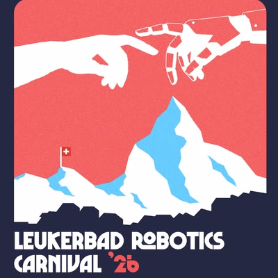</td>
    <td align="left">
      🏆 <strong>Category winner: Elderly and Rehabilitation</strong><br>
      🥉 <strong>3rd place overall</strong><br>
      <sub>Leukerbad Robotics Carnival '26 · Hackathon, 14 to 16 Nov 2026<br>Simon, Henry, Sima, Sebas</sub>
    </td>
  </tr>
</table>

</div>

<br>

| **2 hands · 40 joints** | **5 pieces** | **about 20 s** | **62 / 62** |
|:--:|:--:|:--:|:--:|
| on an acoustic upright piano | played with both real hands on 15 Nov | per hand, from a new tune to a plan (8 to 17 min with a full search) | notes of Ode to Joy in simulation, 0 wrong, on all ten test setups |

<p align="center">
  <a href="https://simonkruelle.github.io/Wuji-Quartet/media/real_ode_two_hands.mp4">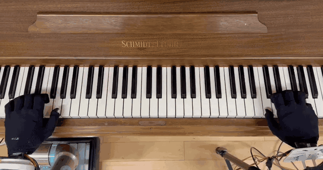</a>
  <br>
  <sub>15 Nov 2026. Both real hands play Ode to Joy: melody right, accompaniment left. The wrists stay where they are; every finger motion comes from the plan.</sub>
</p>

<p align="center"><strong><a href="https://simonkruelle.github.io/Wuji-Quartet/">▶ Watch every video with sound</a></strong> · or click any clip on this page</p>

## Three things it does

<table>
  <tr>
    <th width="33%">1 · Retarget</th>
    <th width="33%">2 · Play</th>
    <th width="33%">3 · Teach</th>
  </tr>
  <tr>
    <td>Any MIDI file becomes a finger plan. No teleoperation, no demonstration on the robot, no training run.</td>
    <td>One or two real hands play it at full speed, in step, on a real piano.</td>
    <td>The robot hand rests on your hand and presses your fingers through the piece, phrase by phrase.</td>
  </tr>
  <tr>
    <td><strong>about 20 s</strong> per hand</td>
    <td><strong>5 pieces</strong> with both hands</td>
    <td><strong>down to 0.3 A</strong> finger current in a lesson; 1.0 A when it plays alone</td>
  </tr>
</table>

- **Why a piano:** it grades dexterity by itself. Every note is right or wrong, early or late.
- **Why it is fast:** what the search learned on one piece (how each finger strikes a key) carries over to the next.
- **Why teach:** the plan that moves the robot's fingers can move yours.
- **Why care homes:** our pitch in the Elderly and Rehabilitation track. A robot that plays the songs residents know becomes familiar, and the same hand can guide a patient's hand.

## Teach: the robot shows your fingers the piece

<table>
  <tr>
    <td width="50%" align="center"><a href="https://simonkruelle.github.io/Wuji-Quartet/media/real_teach.mp4">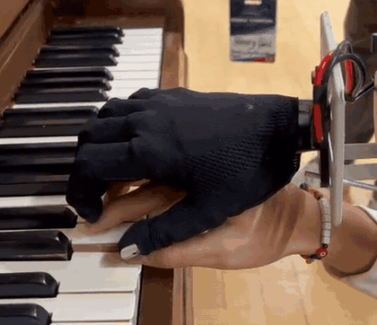</a></td>
    <td width="50%" align="center"><a href="https://simonkruelle.github.io/Wuji-Quartet/media/real_teach_ode.mp4">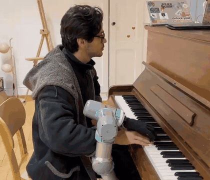</a></td>
  </tr>
  <tr>
    <td>The robot hand lies on the learner's hand and plays the tune through their fingers.</td>
    <td>Sebas takes a lesson: Ode to Joy, 16 Nov.</td>
  </tr>
</table>

<table>
  <tr>
    <th width="25%">1</th>
    <th width="25%">2</th>
    <th width="25%">3</th>
    <th width="25%">4</th>
  </tr>
  <tr>
    <td>Lay your hand on the keys, relaxed, under the robot hand.</td>
    <td>Pick a phrase, the speed and the number of rounds.</td>
    <td>The robot presses your fingers onto the right keys at the right time.</td>
    <td>Pause, then again. Slide your hand out sideways whenever you like.</td>
  </tr>
</table>

| You set | Range |
|---|---|
| Phrase | the piece is cut into up to eight phrases: one of them, or all |
| Speed | 50, 75 or 100 % |
| Rounds | 1 to 10, with 2 to 20 s of pause in between |
| Fingers | all five, or only the ones you practise |
| Force | the finger current limit, 0.3 to 1.5 A |
| On screen | notes fall onto a keyboard in step with the hand, one colour per finger |
| Stop | the red button in the top bar: the hand goes limp and confirms it |

> **Run on the real hand, 16 Nov:** Ode to Joy, three rounds per lesson. The current limit went down step by step from 1.0 A to 0.3 A, and Sebas took a lesson with his hand under it. **Not measured yet:** whether someone plays better after a lesson.

In the studio: Play › Teach.

## Any song

| Source | What it is |
|---|---|
| Ours | Ode to Joy, Jingle Bells, When the Saints, Korobeiniki, Pachelbel's Canon, Mozart K.265, Für Elise |
| 14 Christmas songs | public domain or CC0, verse 1 ([list](assets/songs/README.md)) |
| 153 piano performances | the FürElise dataset: cut an excerpt, simplify it for one hand |
| Your own MIDI file | also a whole band: the studio leaves out the drums and finds the tune |

- **One hand reaches five neighbouring keys**, plus black keys in between. A wider tune is fitted into them: every step between two notes stays exact inside a phrase.
- **Two hands share a tune** over ten keys: `scripts/split_tune.py`.
- Imported songs stay on your computer (`assets/library/` is not in git).

## The studio

<p align="center">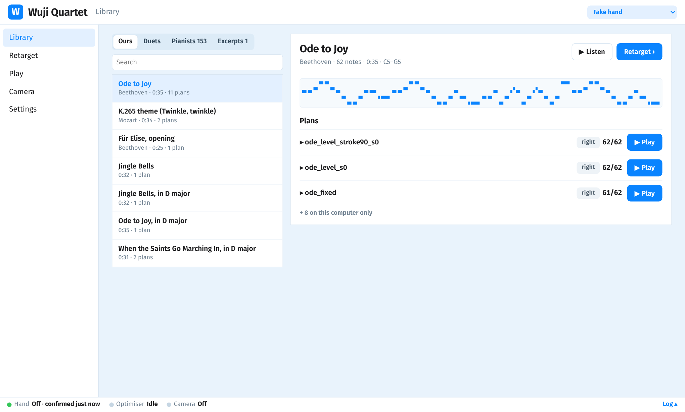</p>

**Pick a piece → listen → retarget → play or teach, in one browser window.** `python gui/app.py`

<table>
  <tr>
    <td width="50%">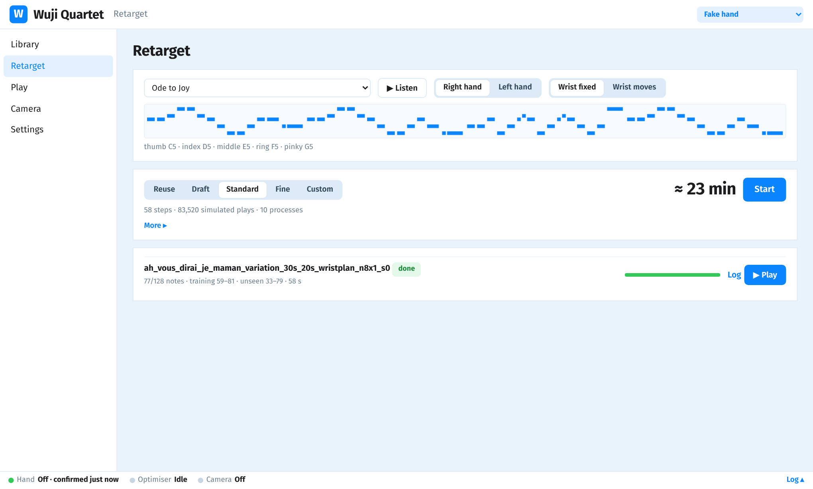</td>
    <td width="50%">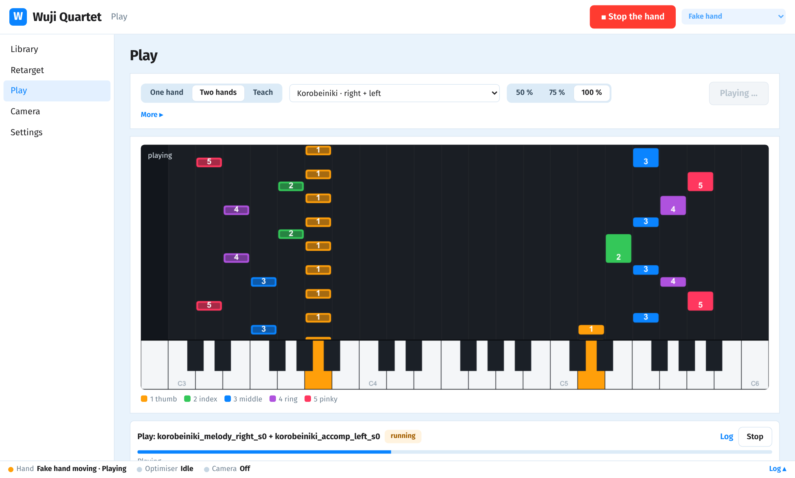</td>
  </tr>
  <tr>
    <td><strong>Retarget</strong>: Reuse, Draft, Standard or Fine. The time comes before you start.</td>
    <td><strong>Play</strong>: one hand, two hands, or Teach.</td>
  </tr>
</table>

| Page | |
|---|---|
| Library | pieces, songs, the 153 performances, your own MIDI files |
| 3D view | every plan in simulation; for K.265 the recorded pianist's hands on the same keyboard |
| Retarget | the search, one hand or both, with a time estimate |
| Hands | both real hands: connected, firmware, first motion, where each hand has to sit for which song |
| Play | one hand · two hands · Teach. Stop is always in the top bar |
| Camera | the hand follows your hand in front of a webcam (Sebas's tracking); not yet run on the real hand from the studio |
| Settings | which hand, the robot computer, defaults |

Guide: [docs/STUDIO.md](docs/STUDIO.md).

## How it works: SBTO

**Guess a motion, try noisy copies of it in a simulator, keep the best, move the guess toward them. Repeat.** No gradients, nothing learned, no demonstration on the robot.

This is **SBTO**, sampling-based trajectory optimisation, developed at the [ATARI Lab](https://www.ce.cit.tum.de/en/aipd/) of TU Munich (Applied and Theoretical Aspects of Robot Intelligence, Prof. Majid Khadiv), where Simon writes his master's thesis. Paper: [DynaRetarget](https://arxiv.org/abs/2602.06827) · code: [Atarilab/sbto](https://github.com/Atarilab/sbto).

<p align="center"></p>

One round, for the next half second of music:

| | Step | On the piano |
|:--:|---|---|
| 1 | A guess with a spread | five numbers per note: **when** the key goes down, **when** it comes up, **how deep**, and a small shift **sideways** and **forward**. The first guess comes from the notes and the finger geometry |
| 2 | Draw 48 tries | random copies of the guess, inside that spread (63 in dense passages) |
| 3 | Simulate each | MuJoCo plays every try on five pianos: softer and stiffer finger servos, the mount up to 2 mm and 1.5° off |
| 4 | Score each | one number: notes missed, notes early or late, wrong keys. The average over the five pianos counts |
| 5 | Keep the 8 best | the guess moves to their average, the spread narrows toward theirs |

**↺ Six rounds.** Then the best try for that half second is kept, and the search moves on to the next.

| | SBTO in Simon's thesis | The piano version here |
|---|---|---|
| A try is | joint commands a quarter second apart for a robot arm and hand, 26 per step | five numbers per note |
| Tries per round · kept | 256 · 32 | 48 · 8 |
| Time window | grows from the first quarter second to the whole clip | slides along the piece, half a second at a time |
| Score | the object moves as in the human's recording, and the hand holds it | the right keys go down at the right time |

- **Reuse:** a new tune takes the per-finger stroke settings the search found on Ode to Joy. No search, about 20 s.
- **Out comes one plan:** 20 joint angles per hand, 1,000 times a second. The hand plays it without feedback.
- `scripts/sbto_piano.py` is our own piano version, written for this weekend. It contains none of the lab's code.

<table>
  <tr>
    <td width="50%">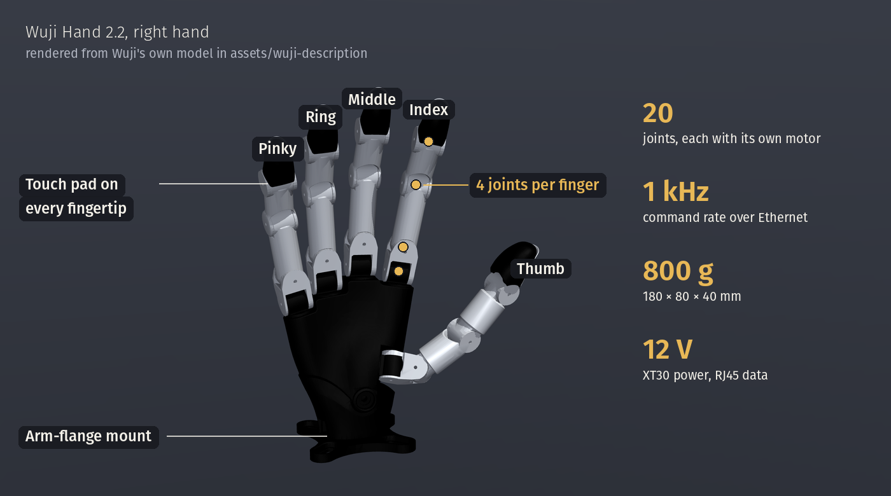</td>
    <td width="50%">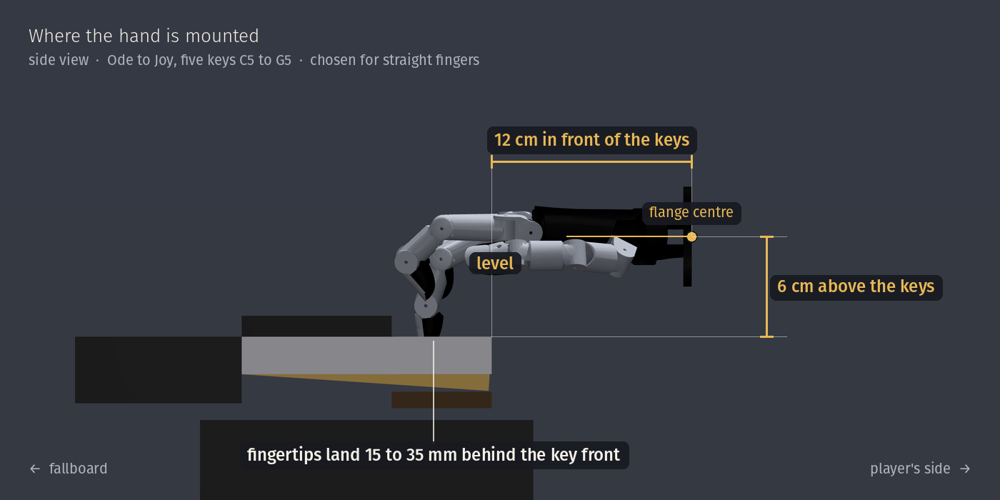</td>
  </tr>
  <tr>
    <td>Wuji Hand 2.2: 20 joints, 1 kHz.</td>
    <td>The hand sits level, 6 cm above the white keys.</td>
  </tr>
</table>

## The piano is the start

**The search does not know what a piano is.** It needs three things: what a human did, a simulator, and a score.

| Swap | For | And the same search gives |
|---|---|---|
| the notes | a recording of a human's hands and the object they hold | a robot arm and hand that move the object the way the person did: the lab's [DynaRetarget](https://arxiv.org/abs/2602.06827) and Simon's thesis |
| the keyboard | strings, valves, drum pads | the same two hands on another instrument |
| the score | "the right string", "the right grip" | any task a simulator can grade |

Human motion in, robot motion out. Built here: the piano. In the end: any instrument.

## On the real hands

Click a picture for the video with sound.

<table>
  <tr>
    <th width="50%">Ode to Joy, both hands</th>
    <th width="50%">Jingle Bells, both hands</th>
  </tr>
  <tr>
    <td align="center"><a href="https://simonkruelle.github.io/Wuji-Quartet/media/real_ode_two_hands.mp4">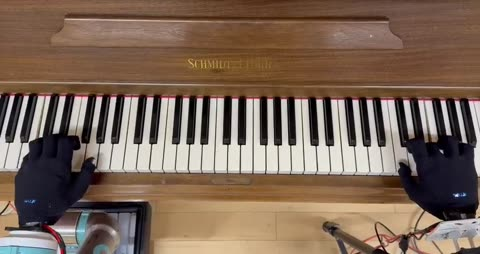</a></td>
    <td align="center"><a href="https://simonkruelle.github.io/Wuji-Quartet/media/real_jingle_two_hands.mp4">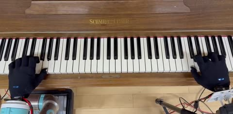</a></td>
  </tr>
</table>

More: [a lesson, close](https://simonkruelle.github.io/Wuji-Quartet/media/real_teach.mp4) · [Sebas's lesson](https://simonkruelle.github.io/Wuji-Quartet/media/real_teach_ode.mp4)

| When | What |
|---|---|
| 14 Nov | first motion: one joint, 9°. Ode to Joy in the air |
| 14 to 15 Nov | right hand: Ode to Joy, Jingle Bells, When the Saints (with F♯), full speed, 1.0 A |
| 15 Nov, afternoon | the studio drives the hand. Korobeiniki, 120 → 200 bpm |
| 15 Nov, 18:42 | the left hand answers: two hands |
| 15 Nov, 20:52 to 23:51 | both hands, from the studio: Korobeiniki, Runaway, Ode to Joy, Jingle Bells, Fly Me to the Moon (with G♯ and C♯) |
| 16 Nov, 00:03 | Teach: lessons on Ode to Joy |

| Measured | Result | From |
|---|---|---|
| Timing | fingers follow the command 23 ms late, the same on every note and on both hands | the hands' own logs, two runs with both hands |
| Notes | 93 of 97 sound at the planned note name | the sound of one phone video. In that run the hands stood one octave too high |
| Not measured | a note-by-note score | no MIDI keyboard was connected |

Every run ends only after the line `hand switched off: confirmed`. Current limit: 1.5 A at most, 1.0 A in every piece above.

## In simulation

Notes hit, before → after the search. The unseen setups were never shown to it.

| Piece | Wrist | Our best guess of the setup | 5 training setups | 5 unseen setups | Wrong notes |
|---|---|:--:|:--:|:--:|:--:|
| Ode to Joy, 62 notes | fixed, level | 0 → **62** | 0 to 62 → 62 | 0 to 33 → 62 | 0 |
| K.265 theme, 80 notes | fixed, first mount | 69 → **76** | 4 to 69 → 47 to 76 | 14 to 65 → 40 to 74 | 1 |
| Für Elise opening, 86 notes | moves, planned from the notes | 72 → **82** | 47 to 75 → 81 to 83 | 5 to 69 → 60 to 83 | 8 |
| K.265 theme, 80 notes | moves, follows a human pianist | 58 → **75** | 38 to 62 → 70 to 75 | 13 to 60 → 56 to 74 | 4 |

Two hands in one simulation, 0 wrong notes: Ode to Joy 62 + 127, Jingle Bells 51 + 123, Korobeiniki 78 + 123, Pachelbel's Canon 26 + 26.

<table>
  <tr>
    <th width="50%">Two hands, Ode to Joy</th>
    <th width="50%">Für Elise, opening</th>
  </tr>
  <tr>
    <td align="center"><a href="https://simonkruelle.github.io/Wuji-Quartet/media/ode_duet.mp4">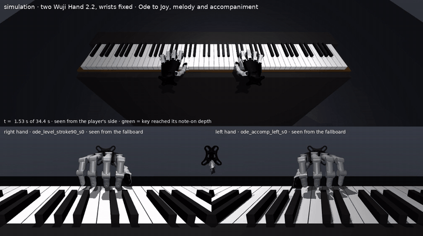</a></td>
    <td align="center"><a href="https://simonkruelle.github.io/Wuji-Quartet/media/furelise_plan.mp4"></a></td>
  </tr>
  <tr>
    <td>Melody right, accompaniment left, both wrists fixed.</td>
    <td>The wrist moves: 27 hand shifts in 25 s. Needs an arm.</td>
  </tr>
</table>

More clips, with sound: [Ode to Joy, one hand](https://simonkruelle.github.io/Wuji-Quartet/media/ode_level.mp4) · [Korobeiniki](https://simonkruelle.github.io/Wuji-Quartet/media/korobeiniki_duet.mp4) · [Jingle Bells](https://simonkruelle.github.io/Wuji-Quartet/media/jingle_two_hands.mp4) · [Pachelbel's Canon](https://simonkruelle.github.io/Wuji-Quartet/media/canon_duet.mp4) · [When the Saints](https://simonkruelle.github.io/Wuji-Quartet/media/saints_dmajor.mp4) · [K.265](https://simonkruelle.github.io/Wuji-Quartet/media/k265_fixed.mp4) · [the recorded pianist and the robot in one picture](https://simonkruelle.github.io/Wuji-Quartet/media/k265_pianist_robot_overlay.mp4) · [and side by side](https://simonkruelle.github.io/Wuji-Quartet/media/k265_pianist_and_robot.mp4). The sound is synthesised from the keys the simulation pressed, wrong notes included.

## Next

Not built yet.

| Step | Why |
|---|---|
| Arms move the wrists | the whole keyboard instead of five keys per hand. In simulation the Für Elise opening already plays with a moving wrist: 82 / 86 |
| The lesson listens | a keyboard's MIDI output scores the learner and picks the next phrase. `scripts/score_midi.py` exists; it is not connected to Teach |
| Loud and soft | every stroke is equally loud today |
| A score on the real piano | a MIDI keyboard under the hands, so every run is graded note by note |
| Another instrument | the same search with a new simulator model and a new score |

## Team

| Who | Role |
|---|---|
| **Simon** | team lead, simulation and optimisation. Master's thesis at the ATARI Lab, TU Munich |
| **Henry** | compute |
| **Sima** | pitch, story, team management |
| **Sebas** | the real hand, sim-to-real, webcam tracking |

---

# Use it

## Set up

| You have | Do | You get |
|---|---|---|
| Docker (Mac, Linux, Windows with WSL) | `./wq build && ./wq check`, then `./wq gui` | the studio: optimise, simulate, render videos |
| Apple-silicon Mac or Linux, without Docker | native install below, then `python gui/app.py` | the same, plus the interactive 3D viewer, the camera page, and it can drive the hand |
| The RDK X5 | [docs/RDK_X5_SETUP.md](docs/RDK_X5_SETUP.md) | drives the hand |

```bash
git clone git@github.com:simonkruelle/Wuji-Quartet.git && cd Wuji-Quartet

./wq build      # once: about 5 min, 1.4 GB
./wq check      # should print: streamed 5100 frames, skipped 0 (late host)
```

<details><summary>Native install (no Docker)</summary>

Python 3.13. Intel Macs are not supported: Wuji publishes no SDK build for them.

```bash
python3.13 -m venv .venv && source .venv/bin/activate      # no python3.13? brew install python@3.13
pip install -r requirements.txt
python scripts/play_on_hand.py plans/k265_fixed/theme_q_1khz.npz --dry-run --yes --end 3
```

Videos also need `ffmpeg` (`brew install ffmpeg`). The camera page also needs `pip install -r requirements-camera.txt`. The pinned packages have builds for Apple silicon; nobody has run this on a Mac yet.

</details>

## Run

Everything below is also a button in the studio (`python gui/app.py`, [docs/STUDIO.md](docs/STUDIO.md)).

```bash
# video with sound of a plan → plans/k265_fixed/theme_sim.mp4
./wq sim python scripts/render_theme.py plans/k265_fixed

# interactive 3D viewer (native install only; on a Mac use mjpython instead of python)
python scripts/view_theme.py plans/k265_fixed

# the fake hand: the full playback path at 1 kHz without hardware
./wq sim python scripts/play_on_hand.py plans/k265_fixed/theme_q_1khz.npz --dry-run
```

## Optimise

```bash
# any single-line melody, wrist fixed
./wq sim python scripts/sbto_piano.py --piece my_tune.mid --wrist fixed --out out/my_tune --workers 10

# the three reference runs, exactly as they were made (15 to 19 min each on 10 cores)
./wq sim python scripts/sbto_piano.py --piece k265     --wrist fixed --out out/sbto_k265_fixed    --workers 10
./wq sim python scripts/sbto_piano.py --piece furelise --wrist plan  --out out/sbto_furelise_plan --workers 10
./wq sim python scripts/sbto_piano.py --piece k265     --wrist human --out out/sbto_k265_human    --workers 10
```

<details><summary>Flags</summary>

| Flag | Meaning | Default |
|---|---|---|
| `--piece` | `k265`, `furelise`, `ode`, or a path to any `.mid` file with a single-line melody | `k265` |
| `--wrist` | `fixed`, `human` (follow the pianist; K.265 only) or `plan` (hand positions planned from the notes) | `fixed` |
| `--gain` | servo stiffness, as a multiple of the model's default | 5 |
| `--mount` | `x,z,pitch,dy`: metres in front of the key hinge line, metres above the white keys, degrees, metres sideways from E5 | `0.22,0.10,25,-0.0235` |
| `--dr` | `wide` or `mild` range of simulated setups | wide for a fixed wrist |
| `--workers` | CPU processes | 10 |
| `--samples` `--elites` `--iters` | search size per half second | 48, 8, 6 |
| `--max-windows N` | stop after N half-second steps: a 1-minute test | off |
| `--seed` | random seed | 0 |

New runs land in `out/` (not tracked). Move a run to `plans/` to share it.

</details>

## On the real hand

1. **[docs/RDK_X5_SETUP.md](docs/RDK_X5_SETUP.md)**: board out of the box, Docker, network, hand answers. All from a Mac terminal, no screen on the board.
2. **[docs/RUNBOOK.md](docs/RUNBOOK.md)**: safety, mount, key calibration, play, [two hands](docs/RUNBOOK.md#two-hands).

Two facts that save an hour: the hand has the fixed address **192.168.1.111** (right) or **.110** (left) and no DHCP, and the RDK X5 ships on **192.168.127.10**. They cannot see each other until `bash scripts/hand_net.sh` has run. The board has one Ethernet port: the second hand goes through a USB-Ethernet adapter in a USB-A port (`scripts/hand_adapter.sh`).

<details><summary>Cables and wiring</summary>

| Item | For | Note |
|---|---|---|
| Power adapter 12 V / 20 A | hand | in the Wuji box |
| Mains cable for it | hand | the boxed one has a **Chinese plug**: bring a travel adapter |
| XT30 extension cable, 2 m | hand | in the Wuji box |
| Ethernet cable, shielded Cat5e, 2 m | hand ↔ robot computer | in the Wuji box |
| Adapter mount and adapter flange | hand ↔ bracket | in the Wuji box |
| USB-C power supply, **5 V / 5 A** | RDK X5 | a laptop USB port is not enough |
| microSD card, 32 GB, and a card reader | RDK X5 | 16 GB is the official minimum |
| USB-Ethernet adapter, in a USB-A port | second hand ↔ RDK X5 | the board's USB-C data port does not work for it |
| USB-C to Ethernet adapter | Mac ↔ RDK X5 (first login), or Mac ↔ hand | one is enough |
| USB cable to the piano, usually USB-A to USB-B | piano ↔ RDK X5 | carries MIDI, so the piano scores the hand (digital pianos only) |
| Optional: micro-USB cable | RDK X5 serial console | the way in if the network login fails |

<p align="center"></p>

</details>

## Plans in this repo

<details><summary>All plans, with what each has done on the real hand</summary>

| Folder | Piece | Wrist | Notes hit in sim | On the real hand |
|---|---|---|:--:|---|
| [`plans/ode_level_stroke90_s0`](plans/ode_level_stroke90_s0) | Ode to Joy, 62 notes | fixed and level, five keys C5 to G5, 90 ms key strokes | 62 / 62, 0 wrong | **played, 15 Nov, many times. Try this first; [duet notes](assets/ode_to_joy/README.md)** |
| [`plans/jingle_level_bpm120_s0`](plans/jingle_level_bpm120_s0) | Jingle Bells chorus, 51 notes, 120 bpm | same mount and keys as Ode to Joy; stroke parameters taken over from the Ode plan, no new optimisation | 51 / 51, 0 wrong | played 15 Nov, full speed, 1.0 A |
| [`plans/saints_dmajor_bpm120_s0`](plans/saints_dmajor_bpm120_s0) | When the Saints Go Marching In, 32 notes, D major | **black-key position**: fixed and level, keys D5 E5 F♯5 G5 A5, the middle finger plays F♯; mount 6 cm above the keys, 11 cm in front, 3 cm right of E5 | 32 / 32, 0 wrong | played 15 Nov, twice, full speed, 1.0 A; [video](https://simonkruelle.github.io/Wuji-Quartet/media/saints_dmajor.mp4) |
| [`plans/ode_dmajor_bpm108_s0`](plans/ode_dmajor_bpm108_s0) | Ode to Joy in D major (Beethoven's key), 62 notes | black-key position | 62 / 62, 0 wrong | not yet |
| [`plans/jingle_dmajor_bpm120_s0`](plans/jingle_dmajor_bpm120_s0) | Jingle Bells chorus in D major, 51 notes | black-key position | 51 / 51, 0 wrong | not yet |
| [`plans/korobeiniki_melody_right_s0`](plans/korobeiniki_melody_right_s0) + [`plans/korobeiniki_accomp_left_s0`](plans/korobeiniki_accomp_left_s0) | **Two hands:** Korobeiniki, first phrase four times, 120 → 200 bpm, 78 + 123 notes | fixed and level, keys D5 to A5 and D3 to A3 (one key right of the Ode position) | 78 / 78 and 123 / 123, 0 wrong | **played with both hands, 15 Nov, twice**; the melody alone before that; [video](https://simonkruelle.github.io/Wuji-Quartet/media/korobeiniki_duet.mp4) |
| [`plans/korobeiniki_melody_right_cem_s0`](plans/korobeiniki_melody_right_cem_s0) + [`plans/korobeiniki_accomp_left_cem_s0`](plans/korobeiniki_accomp_left_cem_s0) | the same piece, with its own search (9 min per hand) | same | 78 / 78 and 123 / 123, 0 wrong | not yet |
| [`plans/ode_accomp_left_s0`](plans/ode_accomp_left_s0) · [`_right_`](plans/ode_accomp_right_s0) | **Two hands:** accompaniment for Ode to Joy, 127 notes, for a left hand · for a second right hand | fixed and level, five keys C3 to G3, mirrored mount for the left hand | 127 / 127, 0 wrong; with `ode_level_stroke90_s0` in one simulation: all notes of both | the piece was played with both hands on 15 Nov, from a pair the studio made from the same MIDI files; [video](https://simonkruelle.github.io/Wuji-Quartet/media/ode_duet.mp4), [setup](docs/RUNBOOK.md#two-hands) |
| [`plans/jingle_accomp_left_s0`](plans/jingle_accomp_left_s0) · [`_right_`](plans/jingle_accomp_right_s0) | **Two hands:** accompaniment for Jingle Bells, 123 notes | same position as the Ode accompaniment | 123 / 123, 0 wrong | as for Ode to Joy |
| [`plans/korobeiniki_accomp_right_s0`](plans/korobeiniki_accomp_right_s0) | Korobeiniki accompaniment for a second right hand | keys D3 to A3 | 123 / 123, 0 wrong | not yet: our second hand is a left hand |
| [`plans/canon_melody_right_s0`](plans/canon_melody_right_s0) + [`plans/canon_bass_left_s0`](plans/canon_bass_left_s0) | **Two hands:** Pachelbel's Canon in C, simplified, 72 bpm, 26 + 26 notes | each thumb reaches one key beyond the five-finger position; right hand centred on C5, left hand on G3 | 26 / 26 and 26 / 26, 0 wrong; optimised | not yet; [video](https://simonkruelle.github.io/Wuji-Quartet/media/canon_duet.mp4) |
| [`plans/ode_level_s0`](plans/ode_level_s0) | Ode to Joy, 62 notes | same as the first row, strokes as fast as the joints allow | 62 / 62, 0 wrong | jerky when it plays alone; used for the Teach lessons on 16 Nov |
| [`plans/k265_fixed`](plans/k265_fixed) | K.265 theme | fixed, first mount | 76 / 80, 1 wrong | not yet: on the real hand the thumb cannot reach from this mount |
| [`plans/ode_fixed`](plans/ode_fixed) | Ode to Joy, 62 notes | fixed, first mount | 61 / 62, 0 wrong | in the air only (14 Nov); same thumb problem |
| [`plans/baseline_k265_gain5`](plans/baseline_k265_gain5) | K.265 theme | fixed, not optimised | 72 / 80, 0 wrong | used by the stiffness and calibration steps |
| [`plans/furelise_plan`](plans/furelise_plan) | Für Elise opening | planned, 27 shifts | 82 / 86, 8 wrong | no, needs an arm |
| [`plans/k265_human`](plans/k265_human) | K.265 theme | follows the pianist | 75 / 80, 4 wrong | no, needs an arm |

Runaway and Fly Me to the Moon were played from plans in `out/`. Their MIDI files are someone else's arrangement of a song under copyright and stay out of git.

</details>

<details><summary>What is in a plan folder</summary>

| File | Content |
|---|---|
| `theme_q_1khz.npz` | the plan: `q` = joint commands at 1 kHz (20 columns for the hand, 3 more for a moving wrist), plus notes, fingering, mount, stiffness, per-finger command lead |
| `scene.xml` | the MuJoCo scene it was made for |
| `report.json` | scores on all setups, before and after |
| `target.mid` · `sim_played.mid` | what should sound · what the simulation played |
| `cem_params_v1.npz` · `report_v1.json` · `log.txt` | the optimiser's raw result and log |
| `right.replay` | baseline only: the same plan in Wuji's own replay format |

Joint order everywhere is Wuji's: thumb 0 to 3, index 4 to 7, middle 8 to 11, ring 12 to 15, pinky 16 to 19.

</details>

## Repo map

<pre>
Wuji-Quartet/
├── <a href="wq">wq</a>                      Docker helper: build · sim · hand · shell · check · gui
├── <a href="gui/">gui/</a>                    the studio: <a href="gui/app.py">app.py</a> (server) · jobs · library · planner · simplify · startpose · static/ (the pages). Guide: <a href="docs/STUDIO.md">docs/STUDIO.md</a>
├── <a href="Dockerfile">Dockerfile</a> · <a href="requirements.txt">requirements.txt</a>   one image for PCs (amd64) and the RDK X5 (arm64), versions pinned
├── <a href="scripts/">scripts/</a>
│   ├── <a href="scripts/sbto_piano.py">sbto_piano.py</a>       the optimiser: notes → fingering → plan → 5-setup search → plan folder
│   ├── <a href="scripts/piano_core.py">piano_core.py</a>       88-key piano + hand scene, finger IK, trajectory, simulation, scoring
│   ├── <a href="scripts/play_on_hand.py">play_on_hand.py</a>     1 kHz playback on the hand, logs every real run, --dry-run
│   ├── <a href="scripts/play_duet.py">play_duet.py</a> · <a href="scripts/hand_off.py">hand_off.py</a>    two hands in step · switch every hand off and confirm it
│   ├── <a href="scripts/make_melody.py">make_melody.py</a> · <a href="scripts/make_duet.py">make_duet.py</a>   five-finger tunes for one hand · for two hands
│   ├── <a href="scripts/split_tune.py">split_tune.py</a>       one tune shared between two hands: ten keys, fills in the rests, black keys
│   ├── <a href="scripts/render_theme.py">render_theme.py</a> · <a href="scripts/view_theme.py">view_theme.py</a>    video with sound · interactive viewer
│   ├── <a href="scripts/render_duet.py">render_duet.py</a>      two plans in one simulation: score, hand-to-hand contacts, video (--present: 1080p with piano sound)
│   ├── <a href="scripts/render_human_robot.py">render_human_robot.py</a>   presentation video: the recorded pianist and the robot plan made from it, with sound
│   ├── <a href="scripts/plan_view.py">plan_view.py</a>        one plan simulated once for the studio's 3D view
│   ├── <a href="scripts/make_theme.py">make_theme.py</a>       fast plan without optimisation (30 s), takes the key calibration
│   ├── <a href="scripts/sweep_pose.py">sweep_pose.py</a> · <a href="scripts/sweep_mount.py">sweep_mount.py</a>   where the hand should sit: by finger posture · by notes hit
│   ├── <a href="scripts/sysid_step.py">sysid_step.py</a> · <a href="scripts/calibrate_keys.py">calibrate_keys.py</a>   real stiffness · right key and depth
│   ├── <a href="scripts/hand_info.py">hand_info.py</a> · <a href="scripts/hand_hello.py">hand_hello.py</a>   read-only hand check · first motion: one joint, 9°
│   ├── <a href="scripts/hand_net.sh">hand_net.sh</a> · <a href="scripts/hand_adapter.sh">hand_adapter.sh</a>   network to the hand · to the second hand
│   ├── <a href="scripts/rdk_setup.sh">rdk_setup.sh</a>        one-time setup of the RDK X5: Docker with the fixes its kernel needs
│   ├── <a href="scripts/wuji_hw.py">wuji_hw.py</a>          SDK session, current limit, confirmed switch-off, fake hand
│   ├── <a href="scripts/teleop.py">teleop.py</a>           Sebas's webcam teleop, standalone (needs his handlib module, not in this repo) · <a href="scripts/hand_features.py">hand_features.py</a> its angle maths
│   ├── <a href="scripts/camera_track.py">camera_track.py</a> · <a href="scripts/hand_follow.py">hand_follow.py</a>   the same tracking as two halves: camera → joint targets · targets → hand
│   └── <a href="scripts/score_midi.py">score_midi.py</a> · <a href="scripts/run_sbto_all.sh">run_sbto_all.sh</a>   recorded MIDI vs plan · the three reference runs in a row
├── <a href="plans/">plans/</a>                  finished plans (see above)
├── <a href="hardware/">hardware/</a>               printable tripod bracket for the hand (STL + the script that makes it)
├── <a href="results/">results/</a>                mount sweeps, front and back approach
├── <a href="assets/">assets/</a>
│   ├── wuji-description/   Hand 2.1 and 2.2: MuJoCo model, URDF, meshes, flange drawings
│   ├── melodies/ · duets/  tunes for one hand · one MIDI file per hand for two hands
│   ├── songs/              14 Christmas songs, verse 1, tune as part 1 (public domain / CC0; <a href="assets/songs/README.md">list</a>)
│   ├── furelise/           the MIDI of all 153 performances; for K.265 also the pianist's wrist path and hands
│   ├── fur_elise_beethoven/   Für Elise MIDI
│   └── ode_to_joy/         Ode to Joy MIDI, left-hand chords for a duet
└── <a href="docs/">docs/</a>                   <a href="docs/STUDIO.md">STUDIO.md</a> · <a href="docs/RUNBOOK.md">RUNBOOK.md</a> · <a href="docs/RDK_X5_SETUP.md">RDK_X5_SETUP.md</a> · pictures (<a href="docs/make_figures.py">make_figures.py</a>) · media/
</pre>

<details><summary>Known limits</summary>

| Limit | Detail |
|---|---|
| No score on the real piano | no MIDI keyboard was connected; the real results are logs, videos and ears |
| Teaching | run on the real hand with a person's hand under it; no test yet of what a learner gains |
| Fixed wrist reaches five neighbouring keys | six with the thumb's stretch; a wider song is simplified in the studio, or needs `--wrist plan` (a moving wrist, so an arm) |
| Moving wrist is an ideal arm | three stiff sliding axes stand in for the arm; no real arm model |
| One line per hand | each hand plays its tune, plus up to two chord notes (one key per finger); a piece for two hands is two plans |
| Two hands side by side | thumbs on neighbouring keys touch: those plans move each hand 6 mm outward |
| Loudness | every stroke is equally loud |
| Left hand | its model is an exact mirror of the right one; its real joint stops are not measured |
| Robot computer | 12 to 15 % of the 1 kHz commands leave late on every real run; the rhythm stays (see timing above) |
| Piano model | generic key weight and travel (RoboPianist's constants), not our piano |
| Stiffness | all plans assume servos 5 times stiffer than the model's shipped default |
| Für Elise "wrong" notes | about half of the 8 are the right key, 50 to 70 ms off |
| K.265 ending | the last three-note turn (100 ms per note) never plays |
| MuJoCo 4.0 | not used: nothing here is deformable; pinned to 3.17 |

</details>

<details><summary>Not in the repo, and how to get it</summary>

| What | Size | Get it |
|---|---|---|
| The pianists' motion capture | 50 GB for all 153 pieces (median 278 MB each); K.265 is 590 MB | `python scripts/furelise_peek.py assets/furelise` fetches K.265. Only needed to recompute a wrist path; K.265's is already in `assets/furelise/15/wrist_u.npz` |
| USD files, full-hand STEP files | 400 MB | `git clone --depth 1 https://github.com/wuji-technology/wuji-description` |
| MediaPipe hand model for the camera page | 8 MB | the button on the Camera page, or `python scripts/camera_track.py --fetch-model` |
| Runaway, Fly Me to the Moon | | import your own MIDI file in the studio: Library › + Import a MIDI file |

</details>

<details><summary>Sources and licences</summary>

| Part | From | Licence |
|---|---|---|
| Hand model in `assets/wuji-description` | [wuji-technology/wuji-description](https://github.com/wuji-technology/wuji-description), cloned 10 Nov 2026, subset | MIT, © 2025 Wuji Technology ([LICENSE](assets/wuji-description/LICENSE)) |
| K.265 MIDI, wrist path and hands in `assets/furelise/15`; the MIDI of all 153 performances in `assets/furelise/midi` | [FürElise dataset](https://huggingface.co/datasets/rcwang/for_elise) ([paper](https://arxiv.org/abs/2410.05791)) | CC BY-NC 4.0: **non-commercial use only** |
| `assets/fur_elise_beethoven/fur_elise.mid` | [Mutopia Project](https://www.mutopiaproject.org/) | public domain |
| `assets/songs/` (14 Christmas songs) | Wikimedia Commons settings by Rabanus Flavus; Open Hymnal Project ([list with links](assets/songs/README.md)) | CC0 or public domain; every melody is public domain |
| The search method, SBTO | [ATARI Lab](https://www.ce.cit.tum.de/en/aipd/), TU Munich: [DynaRetarget](https://arxiv.org/abs/2602.06827) (Dhédin, Taouil, Omar, Yu, Tao, Dai, Khadiv) · [Atarilab/sbto](https://github.com/Atarilab/sbto) | the method only; none of their code is in this repo |
| Piano key model | constants from [RoboPianist](https://github.com/google-research/robopianist) | Apache 2.0 |
| Leukerbad Robotics Carnival '26 logo in `docs/media` | the event's page, [luma.com/yo2pk18n](https://luma.com/yo2pk18n) | © the organisers; shown to name the event |
| Hand control | [wuji-sdk](https://github.com/wuji-technology/wuji-sdk) · [Wuji Hand 2 docs](https://docs.wuji.tech/docs/en/wuji-hand/latest/) | |
| Hand tracking in the camera page | [MediaPipe Hand Landmarker](https://ai.google.dev/edge/mediapipe/solutions/vision/hand_landmarker), downloaded on first use | Apache 2.0 |
| Our code | this repo | no licence chosen yet |

</details>

<div align="center"><sub>Updated 17 Nov 2026 · simulation numbers come from <code>plans/*/report.json</code>, real-hand runs from the studio's run log and the hands' own logs</sub></div>
