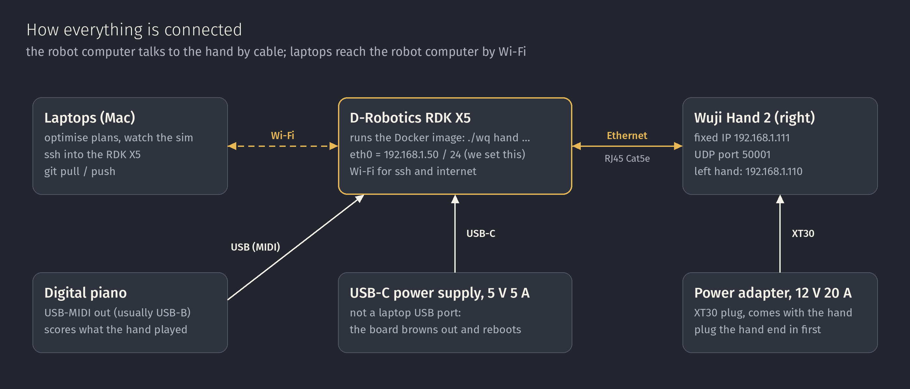

# RDK X5 setup: from the sealed box to a hand that answers

The D-Robotics RDK X5 is our robot computer. It sits next to the hand, is wired to it, and plays the plans. Laptops reach it over Wi-Fi.

**Status, 14 Nov 2026.** Every step below is taken from the official D-Robotics and Wuji documentation (links at the end). **None of it has run on our board yet.** Steps we could test without the board are marked *tested*; the rest is marked *from the docs*. Please correct this page as you go.

| Step | What | Time | Checked how |
|---|---|---|---|
| 1 | Flash the microSD card | 15 min | from the docs |
| 2 | First boot | 2 min | from the docs |
| 3 | First login | 5 min | from the docs |
| 4 | Wi-Fi, password | 5 min | from the docs |
| 5 | Docker | 5 min | Docker's standard Ubuntu install, **not yet tried on an RDK X5** |
| 6 | Repo and image | 10 min | image *tested* on a PC (x86); arm64 wheels exist for every package |
| 7 | Network to the hand | 2 min | addresses from the Wuji docs; script syntax *tested* |
| 8 | Connect the hand, read-only check | 5 min | script *tested* without a hand |
| 9 | Piano (MIDI) | 2 min | from our scripts |



---

## What you need

| Item | Detail | Source |
|---|---|---|
| RDK X5 board | | |
| USB-C power supply, **5 V / 5 A** | into the **power** USB-C port (No. 1). A laptop USB port is not enough: the board shuts down or reboots in a loop | D-Robotics |
| microSD card, **16 GB or more** | D-Robotics' minimum is 16 GB. We suggest 32 GB: the system plus our 1.4 GB image | D-Robotics / our suggestion |
| microSD reader for your laptop | | |
| USB-C to Ethernet adapter for a Mac | for the first login (step 3A) | |
| Ethernet cable | the hand ships with one (shielded Cat5e, 2 m) | Wuji |
| Optional: micro-USB cable | serial console, if the network login fails (step 3C) | D-Robotics |
| Optional: HDMI monitor and USB keyboard | only for the desktop image (step 3B) | |

The board's ports, from the official interface list: **1** power (USB-C) · **3** QuickLink (USB-C, device mode: flashing, ADB) · **4** debug serial (micro-USB) · **6** Gigabit Ethernet · **7** four USB 3.0 type A · **10** HDMI · **13** microSD slot, on the **bottom**.

---

## 1 · Flash the microSD card

1. Download the **server** image (no desktop; we log in over the network):

   ```
   https://archive.d-robotics.cc/downloads/os_images/rdk_x5/rdk_os_3.5.0-2026-4-9/rdk-x5-ubuntu22-preinstalled-server-3.5.0-arm64.img.xz
   ```

   2.2 GB, RDK OS 3.5.0 (April 2026, the newest on the server on 14 Nov), based on Ubuntu 22.04.
   If you have a monitor and keyboard and prefer a desktop, take `rdk-x5-ubuntu22-preinstalled-desktop-3.5.0-arm64.img.xz` (2.8 GB) from the same folder.

2. Check the download (macOS):

   ```bash
   md5 rdk-x5-ubuntu22-preinstalled-server-3.5.0-arm64.img.xz
   # expected: ec3aac7fff7ccd807d1e23a04edd115b
   ```

3. Write it to the card. D-Robotics names two tools: **RDK Studio** (Windows and macOS, https://developer.d-robotics.cc/en/rdkstudio) and **Rufus** (Windows). balenaEtcher also writes `.img.xz` files. If your tool wants a plain `.img`, unpack first: `xz -dk <file>.img.xz`.

4. Eject the card properly.

> Do not flash the "NAND firmware" on a new board. D-Robotics: boards ship with matching firmware, and a downgrade can brick the device.

## 2 · First boot

1. Push the card into the slot on the **bottom** of the board. Never pull or insert the card while the board is on.
2. Plug the 5 V / 5 A supply into the **power** USB-C port (No. 1), not the QuickLink port (No. 3).
3. Wait about a minute. The first boot sets itself up for about 45 seconds. The green power light and the orange light blink when the supply is fine.

## 3 · First login

Default accounts (change the password in step 4):

| User | Password |
|---|---|
| `sunrise` | `sunrise` |
| `root` | `root` |

Pick one way in.

**A · Ethernet from a Mac (no monitor needed).** Out of the box the wired port has the fixed address **192.168.127.10**, mask 255.255.255.0.

1. Cable: Mac's USB-C Ethernet adapter to the board's Ethernet port.
2. Mac: System Settings → Network → the adapter → Details → TCP/IP → Configure IPv4 **Manually** → IP address `192.168.127.100`, subnet mask `255.255.255.0`, router empty.
3. Then:

   ```bash
   ping -c 3 192.168.127.10
   ssh sunrise@192.168.127.10        # password: sunrise
   ```

**B · Monitor and keyboard.** Desktop image only: HDMI and a USB keyboard, log in on screen. If nothing shows for 2 minutes, use C.

**C · Serial console.** Micro-USB cable from port No. 4 to the laptop. Settings: **115200** baud, 8 data bits, no parity, 1 stop bit, no flow control. The adapter chip is a CH340; some computers need its driver. On a Mac:

```bash
ls /dev/tty.usbserial* /dev/tty.wchusbserial* 2>/dev/null
screen /dev/tty.usbserial-XXXX 115200          # log in as root / root; leave with Ctrl-A then K
```

## 4 · Wi-Fi and password

On the board:

```bash
sudo nmcli device wifi rescan
sudo nmcli device wifi list
sudo wifi_connect "NETWORK NAME" "PASSWORD"      # prints: Device 'wlan0' successfully activated
ip -4 -br addr show wlan0                         # write this address on a sticker on the board
passwd                                            # the default password is public; change it on a shared network
sudo passwd root
date                                              # must show today's date, otherwise downloads fail
```

From every laptop on the same Wi-Fi: `ssh sunrise@<that address>`.

| If | Then |
|---|---|
| laptops cannot reach the board over Wi-Fi | guest networks often block device-to-device traffic. Use a phone hotspot for laptops and board, or a small Ethernet switch |
| the Wi-Fi itself uses 192.168.1.x | it collides with the hand's addresses (step 7). Use another network or a hotspot |
| `apt` reports a missing key (`NO_PUBKEY`) | `sudo wget -O /usr/share/keyrings/sunrise.gpg http://archive.d-robotics.cc/keys/sunrise.gpg` (D-Robotics FAQ) |

Updating the system (`sudo apt update && sudo apt full-upgrade`, then reboot) is recommended by D-Robotics but not needed for us. Skip it on a slow network.

## 5 · Docker

D-Robotics has no Docker page for the RDK X5. This is Docker's standard install for Ubuntu 22.04 on arm64. Wuji tests its own SDK container the same way on a Jetson (also arm64).

```bash
curl -fsSL https://get.docker.com | sudo sh
sudo usermod -aG docker sunrise
exit                                    # log in again so the group applies
docker run --rm hello-world             # prints "Hello from Docker!"
```

<details><summary>If Docker does not work on the board: install without it</summary>

Ubuntu 22.04 has Python 3.10, and MuJoCo 3.17 needs 3.11 or newer, so use `uv` to get Python 3.13:

```bash
curl -LsSf https://astral.sh/uv/install.sh | sh && source ~/.bashrc
cd ~/Wuji-Quartet
uv venv --python 3.13 .venv && source .venv/bin/activate
uv pip install -r requirements.txt
python scripts/play_on_hand.py plans/k265_fixed/theme_q_1khz.npz --dry-run --yes --end 3
```

Then run every `./wq hand python …` command below as plain `python …`.

</details>

## 6 · Repo and image

The repository is private, so the board needs a key. On the board:

```bash
ssh-keygen -t ed25519 -N "" -f ~/.ssh/id_ed25519 && cat ~/.ssh/id_ed25519.pub
```

Paste the printed line into GitHub → Wuji-Quartet → Settings → Deploy keys → Add deploy key (tick "Allow write access" if the board should push logs). Then:

```bash
git clone git@github.com:simonkruelle/Wuji-Quartet.git ~/Wuji-Quartet
cd ~/Wuji-Quartet
./wq build          # downloads about 1 GB; 5 to 15 min depending on the network
./wq check
```

`./wq check` must print these lines among others (on the board the machine name is `aarch64`):

```
python 3.13.x aarch64 | mujoco 3.17.0 | wuji-sdk import ok
ok: 36.6 s plan, 20 actuators, 88 keys
[dry-run] fake hand, first-order lag 30 ms
streamed 5100 frames, skipped 0 (late host)
```

"skipped" counts 1 kHz frames the computer was too late for. A few are harmless. Hundreds mean the board is too busy: close other programs.

<details><summary>Slow network at the venue? Build on an Apple-silicon Mac and send the image</summary>

Apple-silicon Macs and the RDK X5 are both arm64, so the image is the same:

```bash
./wq build                                                        # on the Mac
docker save wuji-quartet:local | ssh sunrise@<board address> docker load
```

No GitHub key on the board? Copy the folder instead: `rsync -a --exclude out ./ sunrise@<board address>:~/Wuji-Quartet/`

</details>

## 7 · Network to the hand

The hand has a **fixed address and no DHCP** (Wuji docs):

| | Right hand | Left hand |
|---|---|---|
| Address | **192.168.1.111** | 192.168.1.110 |
| Subnet mask | 255.255.255.0 | 255.255.255.0 |
| Port | UDP 50001 | UDP 50001 |

The board's wired port is on 192.168.127.x, so it cannot see the hand yet. Give it a second address on the hand's network. First make sure you are logged in over **Wi-Fi**, then move the Ethernet cable from the laptop to the hand (hand still **unpowered**, see step 8) and run:

```bash
cd ~/Wuji-Quartet
bash scripts/hand_net.sh            # adds 192.168.1.50/24 to eth0 and pings the hand
```

This lasts until the board reboots; run it again after each boot. It adds an address and no gateway, so the internet stays on Wi-Fi and the old 192.168.127.10 address keeps working.

<details><summary>Make it permanent (D-Robotics' method)</summary>

Edit the `eth0` block in `/etc/network/interfaces` and restart the network. Leave out any `gateway` line, or the board will try to reach the internet through the hand:

```
auto eth0
iface eth0 inet static
    address 192.168.1.50
    netmask 255.255.255.0
```

```bash
sudo restart_network
```

After this the board no longer answers on 192.168.127.10.

</details>

## 8 · Connect the hand and check it (nothing moves)

Order matters (Wuji docs). Neither cable may be plugged or unplugged while the hand is powered.

1. Ethernet cable: hand to the board's Ethernet port.
2. XT30 power cable into the **hand first**.
3. Then the 12 V / 20 A adapter into the wall. The adapter's mains cable has a Chinese plug: bring a travel adapter.
4. Status light on the back of the hand: blue breathing (self-check), then white breathing (ready). If it is not white after 30 seconds, see Wuji's troubleshooting page.

```bash
bash scripts/hand_net.sh                       # "hand answers at 192.168.1.111 (right hand)"
./wq hand python scripts/hand_info.py          # read-only: serial number, firmware, 20 of 20 joints, joint angles
```

Write the firmware version into the team chat. Position mode needs a newer firmware than MIT mode, and Wuji's two pages disagree on which (2.5.1 is listed as current for Hand 2.2, the SDK example asks for 3.0.0). MIT mode is our default and works on both.

To power down: stop the program (Ctrl-C disables the hand), wait until the hand is still, unplug the adapter from the wall, then the cables.

## 9 · Piano

Plug the piano's USB-MIDI socket into one of the board's USB-A ports.

```bash
ls /dev/snd/                       # a new entry like midiC1D0 appears
./wq hand amidi -l                 # lists the keyboard by name
```

Use that device name in the runbook: `--midi-dev /dev/snd/midiC1D0`.

**Next: [RUNBOOK.md](RUNBOOK.md)**, from the first motion in the air to the full piece.

---

## No RDK X5? An Apple-silicon Mac can drive the hand directly

Wuji publishes its SDK for macOS on Apple silicon (not for Intel Macs). Docker on a Mac cannot reach the hand, so use the native install from the README, then:

1. USB-C Ethernet adapter to the hand. System Settings → Network → adapter → TCP/IP → Manually → `192.168.1.50`, mask `255.255.255.0`.
2. `ping 192.168.1.111`, then `python scripts/hand_info.py`. If macOS asks whether to allow incoming connections, choose Allow.
3. Live MIDI scoring in our scripts is Linux-only. On a Mac record with any MIDI app and score the file with `scripts/score_midi.py`, and calibrate with `--manual`.

## Sources

- D-Robotics RDK X5: [hardware interfaces](https://developer.d-robotics.cc/rdk_x_doc/en/Quick_start/hardware_introduction/rdk_x5) · [flashing](https://d-robotics.github.io/rdk_doc/en/Quick_start/install_os/rdk_x5/system_burn) · [remote login](https://d-robotics.github.io/rdk_doc/en/Quick_start/remote_login) · [network](https://d-robotics.github.io/rdk_doc/en/System_configuration/network_blueteeth) · [FAQ](https://d-robotics.github.io/rdk_doc/en/FAQ/hardware_and_system) · [image server](https://archive.d-robotics.cc/downloads/os_images/rdk_x5/)
- Wuji Hand 2: [quick start](https://docs.wuji.tech/docs/en/wuji-hand/latest/quick-start.md) · [electrical and network](https://docs.wuji.tech/docs/en/wuji-hand/latest/electrical-network-integration.md) · [SDK in Docker](https://docs.wuji.tech/docs/en/wuji-sdk/latest/docker-deployment.md) · [troubleshooting](https://docs.wuji.tech/docs/en/wuji-hand/latest/troubleshooting.md)
- Docker: [install on Ubuntu](https://docs.docker.com/engine/install/ubuntu/)
