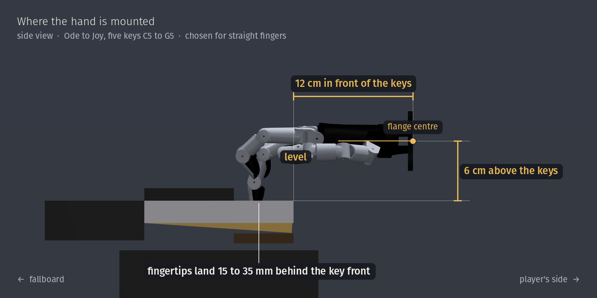

# Runbook: from the first motion to the full piece

**Status, 15 Nov 2026, morning: one right hand plays three pieces from this repo at full speed and 1.0 A** (Ode to Joy, Jingle Bells, When the Saints in D major; every run complete, peak current 0.9 A). The key check (step 4) has no recorded result yet. **Two hands are prepared in simulation only**: see [Two hands](#two-hands).

Before you start: [RDK_X5_SETUP.md](RDK_X5_SETUP.md) is done and `./wq hand python scripts/hand_info.py` shows 20 of 20 joints.

Commands are written for the RDK X5. With a native install (Mac, Linux laptop) drop the `./wq hand` prefix.

Prefer buttons? `python gui/app.py` opens the studio: the same scripts behind Play, Teach and Stop ([STUDIO.md](STUDIO.md)). It has been tested with the fake hand only, so the first real runs belong in a terminal, as below.

| Step | Goal | Hand is | Time |
|---|---|---|---|
| 0 | Dry run, no hardware | off | 1 min |
| 1 | How stiff are the real servos? | in the **air** | 10 min |
| 2 | Mount the hand, measure the mount | over the keys, off | 30 min |
| 3 | Plan for our mount and stiffness | | 1 min |
| 4 | Right key? How deep? | over the keys | 10 min |
| 5 | Play: one finger slow → all slow → full tempo | over the keys | 15 min |
| 6 | Optimise for our setup | | 15 to 30 min |

## Safety

- **Ctrl-C stops the stream and disables the hand** in every script. Keep one person on the keyboard of the robot computer.
- The joints go limp when disabled: the hand drops onto the keys. Nothing can break at our forces, but keep fingers and cables out from under it.
- Every script ramps from the current pose to its start pose over 2 seconds.
- Current limit: scripts default to 0.8 A (MIT mode). Wuji suggests 0.5 A for first tests and 1.5 A for gentle holding. Start with `--effort 0.5`.
- **If the network cable drops out, the hand does NOT switch off: it keeps holding its last pose** (seen on 15 Nov, firmware 3.0.0; the link dropped for 2 seconds). The scripts now stop after 0.5 s without data, reconnect, switch the hand off and print `hand switched off: confirmed`. If you are not sure the hand is off: `python scripts/hand_off.py`. Last resort: the hand's power plug.
- Seat the network cable firmly at both ends and keep it away from the moving fingers.
- Never plug or unplug the power or network cable while the hand is powered.
- There is no hardware emergency stop on this hand. Software stop only; the wall plug is the last resort.
- **The first time you enable the hand, and the first run of every new plan: in the air, fingers free.** We do not know yet what the hand does at the moment it is enabled.
- **Tie the hand to something solid** (a strap from the flange to the stand or the table). The printed bracket and the tripod are the weakest parts here: a fall is the likeliest way to damage the hand, not the fingers pressing keys.
- Use only the included 12 V adapter. Stay in MIT mode until it works: Position mode has no low current limit and is untested.
- The script reads the current limit back from the hand and refuses to enable if it is higher than the one you asked for.
- Firmware update: hand lying flat, nothing else running, never cut power during the update.
- Feel the back of the hand after each run. If it is hot, pause.

## Ode to Joy on the tripod: the short path

`plans/ode_level_stroke90_s0` is the plan for the real hand: five keys C5 to G5, one finger each, hand **level**, mount as in step 2, each key stroke takes 90 ms. (`plans/ode_level_s0` is the same plan with strokes as fast as the joints allow: it looks jerky on the real hand. `plans/ode_fixed` is the first version for the old, tilted mount: do not use it on the piano.)

```bash
# hand in the AIR, fingers free
./wq hand python scripts/hand_info.py                                                           # reads only, never moves
./wq hand python scripts/sysid_step.py plans/baseline_k265_gain5/theme_q_1khz.npz --effort 0.5  # step 1: stiffness G
./wq hand python scripts/hand_hello.py                                                          # first motion: one finger, 9 degrees
./wq hand python scripts/play_on_hand.py plans/ode_level_stroke90_s0/theme_q_1khz.npz --tempo 0.5 --effort 0.5   # whole piece in the air

# hand on the tripod over the keys (step 2), strap attached
./wq hand python scripts/calibrate_keys.py plans/ode_level_stroke90_s0/theme_q_1khz.npz --manual --effort 0.5    # each finger presses its key slowly
./wq hand python scripts/play_on_hand.py plans/ode_level_stroke90_s0/theme_q_1khz.npz --tempo 0.5 --fingers index --effort 0.5
./wq hand python scripts/play_on_hand.py plans/ode_level_stroke90_s0/theme_q_1khz.npz --tempo 0.5 --effort 1.0
./wq hand python scripts/play_on_hand.py plans/ode_level_stroke90_s0/theme_q_1khz.npz --effort 1.0
```

- Wrong key in the slow key check: move the tripod sideways. Note sounds very early or not at all: raise or lower the tripod. Aim for a note at 0.8 to 1.2 on every finger. This plan cannot take the depth numbers in software.
- After each run the script prints, per finger, how far it was from its command and how much current it drew. A finger "at the limit" most of the time is pushing against something: stop and look.
- Current limit: **1.5 A is the hard limit** and the scripts refuse more. Measured in the air: at 0.5 A the fingers complete 70 % of each stroke at full speed, at 1.0 A 82 %. Use 0.5 A for anything new, 1.0 A to play.
- On the RDK X5 without Docker: `cd ~/Wuji-Quartet && ~/wq-venv/bin/python scripts/...` instead of `./wq hand python scripts/...`.
- Then send Simon G and the four measured mount numbers: a plan for your exact setup takes 15 minutes (step 6 with `--piece ode`).

## Two hands

**Prepared 15 Nov in simulation only. No second hand has been connected yet, and two real hands have never run together.**

Each hand stays in one place and plays five neighbouring white keys. Hand 1 is our right hand with the plan it already plays. Hand 2 plays the accompaniment; its plan exists for a **left hand** and for a **second right hand**.

| Piece | Hand 1 (right) | Hand 2 is a left hand | Hand 2 is a right hand | Both hands in one simulation |
|---|---|---|---|---|
| Ode to Joy, 108 bpm, 36 s | `plans/ode_level_stroke90_s0` | `plans/ode_accomp_left_s0` | `plans/ode_accomp_right_s0` | 62 / 62 and 127 / 127 notes, 0 wrong |
| Jingle Bells, 120 bpm, 32 s | `plans/jingle_level_bpm120_s0` | `plans/jingle_accomp_left_s0` | `plans/jingle_accomp_right_s0` | 51 / 51 and 123 / 123, 0 wrong |
| Korobeiniki, 120 → 200 bpm, 25 s | `plans/korobeiniki_melody_right_s0` | `plans/korobeiniki_accomp_left_s0` | `plans/korobeiniki_accomp_right_s0` | 78 / 78 and 123 / 123, 0 wrong |
| Pachelbel's Canon in C, simplified, 72 bpm, 43 s | `plans/canon_melody_right_s0` | `plans/canon_bass_left_s0` | none: the bass needs the thumb on the high side | 26 / 26 and 26 / 26, 0 wrong |

Every plan in the table also plays all its notes on all ten simulated setups (mount off by 2 mm, softer and stiffer servos). For the first three pieces nothing new was optimised: every new plan reuses the stroke settings of the Ode plan. The two Canon parts were optimised (4 minutes each): before that, the thumbs missed notes on the soft, 2 mm too high setup. Videos: [ode_duet.mp4](media/ode_duet.mp4), [korobeiniki_duet.mp4](media/korobeiniki_duet.mp4), [canon_duet.mp4](media/canon_duet.mp4).

**Order to try them: Ode to Joy first** (hand 1's plan has already run on the real hand), then Korobeiniki (the fast one), the Canon last: it is the only piece where a finger leaves the five-finger position.

**Where hand 2 goes: the same mount as hand 1, mirrored.**

| | Hand 1 (right) | Hand 2 |
|---|---|---|
| Flange centre over | the middle of **E5** | the middle of **E3**, 32.9 cm to the left (14 white keys) |
| Height, distance, tilt | 6 cm above the white keys, 12 cm in front of the key fronts, level | the same |
| Keys, Ode and Jingle | C5 D5 E5 F5 G5, thumb on C5 | C3 D3 E3 F3 G3; left hand: thumb on G3; right hand: thumb on C3 |
| Korobeiniki | everything one white key (2.35 cm) to the right: centre over F5, keys D5 to A5 | centre over F3, keys D3 to A3 |
| Canon | centre over **C5** (4.7 cm left of the Ode position), keys A4 to E5, the thumb also plays G4 | a left hand, centre over **G3** (23.5 cm left of hand 1), keys E3 to A3, the thumb plays C4 |

Hand 2 can sit over any other E instead (E4 is 16.5 cm from hand 1): same plan, the accompaniment sounds an octave higher.

Canon: both thumbs reach one key beyond the five-finger position and press 7 mm behind the key's front edge; further back they do not reach. The piece is the ground bass three times; the melody enters in round two with Pachelbel's first line, round three is a quarter-note line on the chord notes written for this hand, not Pachelbel's own variation.

**Order for the new hand.** Same rule as for the first one: every new step in the air first, at 0.5 A.

```bash
python scripts/hand_info.py                                   # reads only: both hands listed, LEFT / RIGHT, 20 of 20 joints each
python scripts/hand_hello.py --side left                      # first motion of the new hand: one joint, 9 degrees, in the AIR
python scripts/play_on_hand.py plans/ode_accomp_left_s0/theme_q_1khz.npz --tempo 0.5 --effort 0.5       # its part alone, in the AIR
python scripts/calibrate_keys.py plans/ode_accomp_left_s0/theme_q_1khz.npz --manual --effort 0.5        # over the keys: right key? how deep?
python scripts/play_duet.py plans/ode_level_stroke90_s0 plans/ode_accomp_left_s0 --dry-run              # no hardware: checks the timing
python scripts/play_duet.py plans/ode_level_stroke90_s0 plans/ode_accomp_left_s0 --tempo 0.5 --effort 0.5
python scripts/play_duet.py plans/ode_level_stroke90_s0 plans/ode_accomp_left_s0 --effort 1.0
```

- With two hands connected, every script picks the hand by the plan's side (left or right, read from the serial number: 4th character J = left, K = right). It refuses to guess: two right hands need `--sn` (`play_duet.py --sn-a ... --sn-b ...`).
- `play_duet.py` starts one `play_on_hand.py` per hand with the same start time. If one hand stops, it stops the other. It ends with `both hands switched off: confirmed`; if not, it runs `hand_off.py`, which switches off every hand it finds.
- `--only a` or `--only b` plays one part alone with the same timing.
- Network: a left hand ships at 192.168.1.110, a right hand at 192.168.1.111, both fixed. The RDK X5 has one network port, so two hands need a **network switch**. Two right hands have the same address: one needs a new one first (the `ip_address` parameter in the `wuji` tool, active after a restart of the hand; we have not done this).
- Firmware: our scripts are tested on 3.0.0 only. Check what the new hand reports in `hand_info.py`.

<details><summary>Not known before the second hand is here</summary>

| Unknown | Why it matters |
|---|---|
| Two hands driven from one RDK X5 at once | never run; the board already sends 12 to 16 % of the commands late with one hand |
| The new hand's joint stops | the plans assume the two stops measured on our right hand, mirrored |
| The left-hand model | the planner uses Wuji's left model, an exact mirror of the right one in simulation; no real left hand has confirmed it |
| The thumb's sideways reach (Canon) | the reach is at its limit: at full key depth the thumb ends 1.6 mm short of its target point in the model. The real right thumb stopped at 0.44 rad sideways and the driver clips its command at 0.42 rad; with that clip the plan still plays all notes in simulation. Not tried on the hand |
| Speed of the real hand | the fastest piece on the real hand so far was 120 bpm; Korobeiniki ends at 200 bpm, with eighth notes 150 ms apart |
| Chopsticks | hands side by side, 11.8 cm apart: clean in simulation for two right hands; with a left and a right hand the two thumbs overlap by 1.6 mm. No plan in the repo; `make_duet.py chopsticks` prints the lines to make one |

</details>

To make another two-hand piece: add it to `scripts/make_duet.py` (one note list per hand), run it, and plan each part with the line it prints:

```bash
python scripts/make_duet.py ode
python scripts/sbto_piano.py --piece assets/duets/ode_left.mid --wrist fixed --real-limits --side left --five 55,53,52,50,48 --center 52 \
    --mount 0.27,0.06,0,0.0 --press-x 0.135,0.115,0.115,0.115,0.125 --stroke 0.09 --start-hover \
    --init-from plans/ode_level_stroke90_s0/theme_q_1khz.npz --no-cem --out out/ode_accomp_left --workers 8
python scripts/render_duet.py plans/ode_level_stroke90_s0 out/ode_accomp_left --check        # both hands in one simulation, 10 s
```

`--center` is the key the flange centre sits over; `--five` lists the keys from the thumb to the pinky (a left hand: from the highest key down).

## 0 · Dry run

```bash
./wq check
./wq sim python scripts/play_on_hand.py plans/k265_fixed/theme_q_1khz.npz --dry-run
```

## 1 · Stiffness (hand in the air, away from the keys)

The simulation only plays well if the real finger servos are at least as stiff as "5×" in our model. This is the biggest open risk, so measure it first. The script makes small steps on six joints, fingers lifting, and finds the simulated stiffness that matches.

```bash
./wq hand python scripts/sysid_step.py plans/baseline_k265_gain5/theme_q_1khz.npz --effort 0.5
./wq hand python scripts/sysid_step.py plans/baseline_k265_gain5/theme_q_1khz.npz --mode position      # only if the firmware supports Position mode
```

It prints `best match: gain xG`. Call that number **G**.

| G | Meaning | Do |
|---|---|---|
| 5 or more | as planned | continue |
| 2.5 to 5 | trills and the pinky stretch will drop out | raise `--kp` (6, then 10) and repeat; or Position mode |
| below 2.5 | the plan will miss most notes | same, and plan at half tempo (`--tempo 0.5`) |

## 2 · Mount and measure



Old mount on top, new one below: [wrist_now_vs_new.png](wrist_now_vs_new.png).

| Target | Value | Tolerance before notes are lost |
|---|---|---|
| Approach | from the player's side, right hand, thumb toward the bass | |
| Flange centre above the white key tops | 6 cm | ±2 mm is inside what the plan was trained on |
| Flange centre in front of the white key fronts | 12 cm | the thumb lands 15 mm behind the key front: do not go further back |
| Sideways | flange centre above the middle of E5 | ±2 mm trained |
| Pitch | level (0°): use a spirit level on the back of the hand | ±1.5° trained |

The bracket must be rigid and adjustable in height and pitch. Clamp it to the table or the stand, not to the keyboard's lid. Flange drawings and STEP files: `assets/wuji-description/hand2/hand2_2/attachment/`.

Measure what you actually built, in millimetres and degrees. You need four numbers: height, distance in front of the key fronts, pitch, sideways offset from E5.

This mount is for Ode to Joy. The K.265 plans (`plans/k265_fixed`, `plans/baseline_k265_gain5`) were made for the first mount (10 cm up, 7 cm in front, over D5, 25° down). On the real hand the thumb's sideways joint stops earlier than in the model, so from that mount the thumb cannot reach its keys: those plans need re-planning before they go on a piano.

## 3 · Plan for our mount

```bash
./wq sim python scripts/make_theme.py --gain G --out out/hw \
    --mount-z 0.100 --mount-x 0.220 --theta 25 --mount-dy -0.0235
```

- `--mount-z`: flange height above the white keys, in metres.
- `--mount-x`: 0.15 + distance in front of the key fronts, in metres (7 cm → 0.22).
- `--mount-dy`: sideways offset from E5, in metres, negative toward the bass (−0.0235 = above D5).
- Hand 2.1 instead of 2.2: add `--rev hand2_1`.

Takes about 30 seconds and prints how many of the 80 notes the simulation hits.

## 4 · Key calibration

Each finger slowly presses its home key until the piano reports a note. This tells us whether it is the right key and how deep to press.

```bash
ls /dev/snd/                                         # midiC1D0 or similar = the piano
./wq hand python scripts/calibrate_keys.py out/hw/theme_q_1khz.npz --midi-dev /dev/snd/midiC1D0 --effort 0.5
./wq sim  python scripts/make_theme.py --gain G --out out/hw_cal --calib out/hw/calib.json   # plus the same mount flags as step 3
```

No MIDI: add `--manual` and press Enter when you hear the note.
Wrong key reported: shift the hand sideways and repeat. Do not fix it in software.

## 5 · Play

```bash
./wq hand python scripts/play_on_hand.py out/hw_cal/theme_q_1khz.npz --tempo 0.5 --fingers index --effort 0.5
./wq hand python scripts/play_on_hand.py out/hw_cal/theme_q_1khz.npz --tempo 0.5 --midi-dev /dev/snd/midiC1D0
./wq hand python scripts/play_on_hand.py out/hw_cal/theme_q_1khz.npz --midi-dev /dev/snd/midiC1D0
```

With `--midi-dev` the script prints hit, missed and wrong notes after the run. Without MIDI, record with any app and score the file:

```bash
./wq sim python scripts/score_midi.py recording.mid out/hw_cal/theme_q_1khz.npz
```

Each run writes a log (`hw_<date>_<time>.npz`: commanded and measured joint angles at 1 kHz) next to the plan. Commit the interesting ones: they are how the simulation gets corrected.

## 6 · Optimise for our setup

On a laptop or Henry's machine, not on the RDK X5 (its small processor would need hours):

```bash
./wq sim python scripts/sbto_piano.py --piece k265 --wrist fixed --gain G \
    --mount 0.22,0.10,25,-0.0235 --out out/sbto_hw --workers 8

# Ode to Joy on the level mount (replace the four numbers with your measured ones):
./wq sim python scripts/sbto_piano.py --piece ode --wrist fixed --gain G --real-limits \
    --mount 0.27,0.06,0,0.0 --press-x 0.135,0.115,0.115,0.115,0.125 --stroke 0.09 --start-hover --out out/ode_hw --workers 8
```

Another melody on the same five keys (C5 to G5) needs no new optimisation: it takes over what the optimiser learned on Ode to Joy, per finger. About 20 seconds:

```bash
./wq sim python scripts/make_melody.py jingle            # also: saints, mary; or write your own .mid with one note at a time
./wq sim python scripts/sbto_piano.py --piece assets/melodies/jingle.mid --wrist fixed --real-limits \
    --mount 0.27,0.06,0,0.0 --press-x 0.135,0.115,0.115,0.115,0.125 --stroke 0.09 --start-hover \
    --init-from plans/ode_level_stroke90_s0/theme_q_1khz.npz --no-cem --out out/jingle --workers 8
```

Leave out `--no-cem` to optimise from that start (15 minutes).

**With a black key (D major: D E F♯ G A, the middle finger plays F♯).** The hand stays level and 6 cm above the keys, but moves **3 cm to the right and 1 cm closer**: flange centre 11 cm in front of the key fronts, 3 cm right of the middle of E5. From 12 cm the middle finger is 3 mm short of the black key. Plans for this position: `plans/saints_dmajor_bpm120_s0`, `plans/ode_dmajor_bpm108_s0`, `plans/jingle_dmajor_bpm120_s0`. To make another one:

```bash
./wq sim python scripts/make_melody.py saints --key D
./wq sim python scripts/sbto_piano.py --piece assets/melodies/saints_D.mid --wrist fixed --real-limits --five 74,76,78,79,81 \
    --mount 0.26,0.06,0,0.030 --press-x 0.135,0.115,0.12,0.115,0.115 --stroke 0.09 --start-hover \
    --init-from plans/ode_level_stroke90_s0/theme_q_1khz.npz --no-cem --out out/saints_D --workers 8
```

A new five-key position needs its own mount: `python scripts/sweep_pose.py --keys 74,76,78,79,81` searches one (5 minutes).

`--stroke 0.09` makes each key stroke take 90 ms instead of about 35 ms; `--start-hover` lets the fingers wait above their keys instead of curled up. Without them the plan plays the same notes in simulation but looks jerky on the real hand.

`--mount` is `x,z,pitch,dy` with the same meaning as in step 3. 15 to 30 minutes. Then copy `out/sbto_hw` to the robot computer (commit it under `plans/`, or `rsync`) and play it as in step 5.

## If something goes wrong

| What you see | Likely cause | Do |
|---|---|---|
| `no Wuji Hand 2 found` | network | `bash scripts/hand_net.sh`; cable; power light |
| `x/20 joints online, refusing to move` | a joint did not start | power-cycle the hand; Wuji troubleshooting page |
| `enable timeout` | a joint reports an error | `./wq hand python scripts/hand_info.py`; Wuji troubleshooting page |
| `this plan moves the wrist (needs an arm)` | you picked `plans/furelise_plan` or `plans/k265_human` | use `plans/k265_fixed`, or add `--fingers-only` to see the fingers alone |
| `command faster than 35 rad/s: refusing` | a damaged or hand-edited plan | regenerate it |
| `!!! THE HAND IS STILL SWITCHED ON` | the connection dropped and did not come back | check the network cable, then `python scripts/hand_off.py`; or unplug the hand's power |
| `no joint states from the hand for 0.5 s` | the network link dropped during the run | reseat the cable at both ends; the script switches the hand off by itself |
| many "skipped" frames | robot computer too busy | close other programs; do not optimise on it while playing |
| notes too quiet or missing at the right key | not deep enough | step 4 again; or raise the hand's stiffness |
| wrong neighbouring keys | sideways error | move the hand, then step 4 |
| everything late by a constant amount | servo lag differs from the model | tell Simon: the per-finger command lead is calibrated in simulation |

## What the simulation does not know yet

| Unknown | Why it matters |
|---|---|
| Real servo stiffness | decides whether fast notes play at all (step 1). First data, in the air: 82 % of each stroke at full speed with kp 3 and 1.0 A; a higher kp is untested |
| Real joint stops | two are known (thumb sideways 0.44 rad, index sideways about 0.6 rad; `REAL_LIMITS` in `piano_core.py`); the others are still the model's |
| Command timing on the RDK X5 | 12 to 16 % of the 1 kHz commands go out late; effect on the music unknown |
| Real key weight and where the piano triggers the note | the model uses a generic key; real sensors usually fire before the key bottom, which helps |
| Bracket stiffness | any sway is a height error |
| Position mode behaviour | untested; MIT mode is the default |
