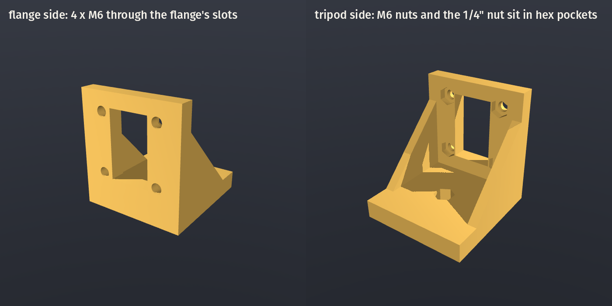

# Tripod bracket for the hand

An L-bracket that bolts Wuji's adapter flange to a camera tripod. **Not test-fitted yet:** the dimensions come from Wuji's flange drawing (`assets/wuji-description/hand2/hand2_2/attachment/…adapter-flange…pdf`), not from the part in our hands. Check the two points below before printing.

| | |
|---|---|
| File | [`tripod_mount.stl`](tripod_mount.stl), 72 × 68 × 75 mm, about 70 g of PLA |
| Print | standing on its foot, as in the picture; 4 walls, 40 % infill, no supports |
| Screws | 4 × M6 × 16 socket-head screws + 4 × M6 nuts (flange), 1 × 1/4"-20 nut (tripod) |
| Hand axis | 44 mm above the tripod plate |

**Check first**
1. The flange in the Wuji box has four slots, 6.2 mm wide, on a 49 mm circle. The bracket's M6 holes sit on a 54 mm circle, inside the slots' range (41 to 57 mm).
2. Your tripod screw is 1/4"-20 (the common camera thread, 6.35 mm). If it is the thick 3/8"-16, change `QTR_D` and `QTR_NUT_AF` in `tripod_mount.py` and run it again.

**Assemble**
1. Press the four M6 nuts into the hex pockets on the back of the upright plate, and the 1/4" nut into the pocket in the foot.
2. Bolt the flange to the plain face: M6 screws from the hand side, through the slots.
3. Screw the foot onto the tripod plate from below.
4. Set height with the tripod's column, pitch (25° down) with the tripod head, sideways by moving the tripod.

**Aim for** flange centre 10 cm above the white keys, 7 cm in front of the key fronts, fingertips 25° down. In simulation the plan tolerates a hand that sits a little too high or too flat much better than one that sits too low or too steep. When unsure, err high and flat, then run the key calibration (`docs/RUNBOOK.md`, step 4).

Change any dimension in [`tripod_mount.py`](tripod_mount.py) (`pip install trimesh manifold3d shapely mapbox-earcut`, then `python hardware/tripod_mount.py`).
